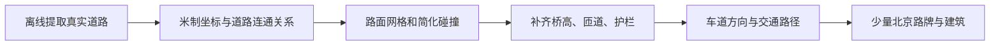

# 玩法与技术调研

[返回文档地图](../MAP.md)

调研日期：2026 年 10 月 31 日。本页保留方案比较与玩法设计理由；当前已确认需求以[产品规格](../产品/产品规格.md)为准，实际工程与验证以[架构地图](../架构/架构地图.md)为准。用户在尝试 Unity 工具后反馈本机运行吃力，已明确本次项目完全采用 Three.js，继续优先复用成熟方案与美术资产。

## 调研结论与已选路线

当前唯一开发主线为 Three.js + Rapier + TypeScript + Vite，沿用已经完成的北京道路、汽车与摩托、警追、城市选车、评分和本机双榜。初始 Godot 建议与中途 Unity 方案属于选型历史；用户实测设备负担后选择继续网页开发，本轮不再迁移引擎。

### 成熟方案的复用边界

当前车控沿用 Rapier 射线悬挂与已有摩托辅助。此前调研过 [Randomation Vehicle Physics](https://github.com/JustInvoke/Randomation-Vehicle-Physics) 的汽车、摩托、变形和掉件，但 Unity 脚本、预制体和车损系统不能直接用于 Three.js。本项目仍需选择网页可用的视觉车损方案，不能将曾导入的 Unity 能力写为网页已实现。

Poly Haven 的 Asphalt 02、Concrete Wall 006、Venice Sunset HDR 与 Adobe Source Han Sans 中文字体源文件已转存至 `public/assets/art/`，当前尚未由游戏代码加载。来源与许可见[资产来源](../../ASSET_LICENSES.md)；下一步在现有道路与车辆镜头中整合材质和光照，并按实际设备体验控制资源负担。

AWSIM 的源码与资产许可分开，资产为 CC BY-NC，且完整自动驾驶示例有平台和 ROS 依赖；LGSVL 存在旧云服务与许可限制。本项目不把它们作为可直接复用的商业化赛车美术库。当前按「成熟社区资源优先、项目独有缺口才自研」推进。

核心卖点可以概括为：在熟悉的真实城市道路中，自由选择主辅路与行驶方向，在不断加码的追捕中累计逃亡里程。优先做出绕开车流、切换道路、躲避撞击和逃脱结算的连续体验。

完整引擎能提供场景、物理、音效、界面与导出，现成车辆示例能减少四轮控制的起步工作；本轮未发现能直接覆盖真实道路、多车种、摩托平衡、持续升级警追和本项目里程规则的完整现成框架。不能把渲染引擎、车辆控制器与完整赛车游戏框架视为同一件事。

## 相近游戏与设计区别

本轮核对的作品中，未发现完全相同的组合；这不代表已穷尽市场，不能宣称全球首创。逆行、警追、多车型和近距离超车评分均已有先例。

| 游戏 | 一手资料能确认的相似点 | 与本项目的差异 |
| --- | --- | --- |
| [Traffic Racer](https://play.google.com/store/apps/details?id=com.skgames.trafficracer) | 无尽、双向、计时与警方追逐模式；高速近失、逆行加分；有公交、货车等交通车辆 | 不能由 NPC 种类推断全部车辆可驾驶；未见真实北京 GIS 与任意方向目标里程组合 |
| [Traffic Rider](https://play.google.com/store/apps/details?id=com.skgames.trafficrider) | 摩托第一视角、车流穿行、逆行与近失加分、排行榜 | 包含购车和升级，不是多车种城市限程警追 |
| [Need for Speed Hot Pursuit Remastered](https://store.steampowered.com/app/1328660/Need_for_Speed_Hot_Pursuit_Remastered/) | 警匪对抗、竞速、警用拦截车、战术装备、Autolog 异步挑战 | 以高性能汽车及装备对抗为主，不是重复累计实际里程逃生 |
| [Need for Speed Most Wanted（2012）](https://www.ea.com/games/need-for-speed/need-for-speed-most-wanted) | 利用地形与捷径摆脱警方、车辆选择和城市驾驶 | 开放世界；此处证据对应 2012 版，不混用 2005 版的通缉系统 |
| [BeamNG.drive](https://store.steampowered.com/app/284160/BeamNGdrive/) | 从轿车到卡车、车辆碰撞、警追场景和计时挑战；[官方 AI 文档](https://docs.beamng.com/tutorials/ai/quick_start/)说明交通违规可触发警方追逐 | 侧重车辆模拟与沙盒，不是本项目这组胜负、警告和评级规则 |

最值得借鉴的是 Traffic Racer 的简单操作与近失反馈、Hot Pursuit 的追击压迫感，以及 BeamNG 的碰撞后果；首版不引入对抗武器、车辆升级和复杂损伤模拟。

用户列出的五个参考作品可各取一个设计原则。下表的借鉴方向是本项目的设计判断，不代表可以直接使用原游戏资产。

| 参考 | 建议借鉴 |
| --- | --- |
| [Mini Motorways](https://dinopoloclub.com/support/mini-motorways/) | 城市关卡卡片、清晰的地图身份、可重复挑战的独立榜单 |
| [Mini Metro](https://dinopoloclub.itch.io/minimetro) | 用真实城市路网的结构差异建立关卡特色，减少不必要的场景堆叠 |
| [Euro Truck Simulator 2](https://eurotrucksimulator2.com/buy.php) | 通过路牌、护栏、路宽、车辆尺度和少量地标建立地点感 |
| [Forza Horizon 5](https://forza.net/es-MX/forzahorizon5) | 优先速度感、跟车镜头、轮胎和动力声音、碰撞反馈及易懂的即时得分 |
| [Google Earth VR](https://blog.google/products-and-platforms/products/google-ar-vr/search-explore-and-more-google-earth-vr/) | 城市选定后用短暂俯瞰镜头下降到道路，交代真实地点 |

[B 站账号页面](https://space.bilibili.com/1745143606)直接访问返回 412，未能核实视频内容，不把猜测当作该 UP 的视频设计。

## 引擎与框架比较

### Godot：初始调研与备选

Godot 具备完整场景编辑器、物理、界面、音频、动画和桌面导出。官方提供 Apple Silicon 版本，[系统要求](https://docs.godotengine.org/en/stable/about/system_requirements.html)列出 M1；这说明平台受支持，不保证本项目达到特定帧率。Godot 和官方示例代码采用 MIT，复用时保留相应许可。

[Truck Town 官方示例](https://github.com/godotengine/godot-demo-projects/tree/master/3d/truck_town)提供多车型选择、四轮驾驶、时速表和多镜头，使用 GDScript、VehicleBody3D。可参考车控、镜头和场景组织，不复制整包项目换皮，也不继承其中本项目不需要的加速道具等机制。

[VehicleBody3D 官方说明](https://docs.godotengine.org/en/stable/classes/class_vehiclebody3d.html)明确指出它存在已知问题，不适合真实车辆模拟。它可作为街机原型的起点，但必须尽早手动体验高速转向、侧面撞击和翻覆；示例不能替代手感调校。

调研时 Truck Town 项目标记 Godot 4.7，与本机 4.7.2 主次版本相符；若回退该路线，仍应固定参考提交。示例使用 Forward+、120 Hz 物理和较高阴影配置，不能原样视为 M1 性能配置。届时应从较低渲染负担、60 Hz 物理和简单灯光开始，渲染器依据实际预览选择。

Truck Town 的声音和部分模型在 README 另列来源，不能由仓库 MIT 推导全部素材可无条件再分发。优先参考控制代码，并使用自制或许可明确的资产。

### 其他路线

| 路线 | 现成能力与起点 | 适合条件与本次代价 |
| --- | --- | --- |
| Unity | 完整引擎；PhysX WheelCollider；[官方车辆教程](https://docs.unity3d.com/6000.0/Documentation/Manual/WheelColliderTutorial.html)含四轮车模型与脚本 | 用户已在另一会话尝试相关工具并反馈本机运行吃力，本次项目不采用；此前关于安装状态和迁移的建议不再作为当前计划 |
| PlayCanvas + Ammo.js | 完整网页引擎；[官方车辆示例](https://developer.playcanvas.com/tutorials/vehicle-physics/)使用 RaycastVehicle；支持[本地代码工作流](https://developer.playcanvas.com/user-manual/engine/standalone/) | 希望采用统一网页编辑器与引擎时的备选；可不依赖云编辑器账户，仍需自建交通、警察、路网和计分 |
| Three.js + Rapier | Three.js 官方已有[车辆示例](https://threejs.org/examples/physics_rapier_vehicle_controller.html)；Rapier 有[射线车辆控制器](https://rapier.rs/javascript3d/classes/DynamicRayCastVehicleController.html) | 当前已选路线。代码迭代、程序化道路与网页界面直接；输入、镜头、声音、比赛状态和评分由项目模块组织，不把官方车控示例当成整套游戏 |
| Babylon.js + Havok | 完整网页引擎，具有界面、场景、音频和物理；[官方 Havok 集成](https://doc.babylonjs.com/features/featuresDeepDive/physics/havokPlugin/)可用 | 本轮未找到同等直接的官方成品车控起点，不能由 Havok 名气推断车辆开发最快，本次不优先 |

PlayCanvas 与 Three.js 的引擎代码采用 MIT，Rapier 和 Babylon.js 为 Apache-2.0；素材许可仍须单独看。Unity 为专有许可，[Personal 资格](https://unity.com/pages/license-compliance)取决于适用主体的财务规模，[Runtime Fee 已取消](https://unity.com/blog/terms-update-runtime-fee-cancellation)。本次不需要为了选型购买商业赛车框架。

若日后导出网页，Godot 应优先 GDScript：[Godot 4 C# 当前不能导出 Web](https://docs.godotengine.org/en/stable/tutorials/export/exporting_for_web.html)，Web 使用 Compatibility/WebGL 2.0。[Unity Web](https://docs.unity.com/en-us/engine/6000.3/manual/platform-specific/webgl/intro/technical-overview)也有平台限制。桌面完成后转网页仍需适配与运行验证，不能承诺无成本导出。

当前 Three.js 原生网页工程直接使用 WebGLRenderer、Timer 与本地 Rapier 包，不依赖官方车辆示例辅助封装默认加载的 CDN。用户补充的[创建场景教程](https://threejs.org/manual/pages/creating-a-scene.html)、[API](https://threejs.org/docs/)和[源码仓库](https://github.com/mrdoob/three.js)用于查阅与复用官方接口，不是安装项目技能的请求。

### 摩托车与物理边界

本轮查到的现成车辆控制器主要解决四轮车，不能直接得到可用的真实两轮平衡。首版摩托建议独立采用街机平衡辅助：正常驾驶保持可控，转弯显示倾斜，较强撞击或失控时允许侧翻；辅助不能让摩托在追捕中永远无法翻倒。

Model Y 体现较大的车宽、质量与加速特征，摩托体现较小通过空间和不同转向响应。车技使用同一套行为规则，物理参数、镜头与碰撞宽度按车型配置，避免只更换外观。

## 北京 GIS 与道路制作

[北京市交通委](https://jtw.beijing.gov.cn/xxgk/dtxx/202503/t20250317_4036222.html)公布四环路全长 65.3 公里，这不是全部辅路的合计长度。即使平均 150 km/h，一圈也约需 26 分钟。精选地图长度与本局目标里程应独立设置：地图提供路线选择，里程决定一局节奏。

当前已离线取得 OpenStreetMap 北四环中关村至学院桥一带数据，并生成本地可驾驶场景。合并路径、来源时间及原始编号见本地数据与[资产来源](../../ASSET_LICENSES.md)。下图保留这条制作管线；道路宽度推定、桥高平面化与程序化建筑是首版明确简化。

[OSM 道路数据](https://wiki.openstreetmap.org/wiki/Highways)可记录道路形状、oneway、lanes、bridge、tunnel 和 layer，但标签不保证齐全。layer 表示相对上下层级，不能当作米级高程；图上相交也不等于可转弯连接。制作时重点处理桥面与桥下、主辅路转换、车道宽度缺失和匝道坡度。[Overpass](https://wiki.openstreetmap.org/wiki/Overpass_API)用于离线查询，不放在每次开局的依赖链中。

首版采用离线路网，不在线加载整座地球。Google 的[摄影测量 3D Tiles](https://developers.google.cn/maps/documentation/tile/3d-tiles?hl=en)能提供视觉，不能直接替代车道图与警方导航。[Cesium for Unity](https://cesium.com/learn/cesium-unity/ref-doc/classCesiumForUnity_1_1Cesium3DTileset.html)确实能创建碰撞网格，问题仍包括流式加载、LOD、缺口与道路语义；不能笼统说瓦片没有碰撞，也不能把摄影测量网格当作成品驾驶场景。

逆行应允许在真实可达路面上完成，中央隔离带和护栏仍形成空间边界；不靠穿越实体护栏实现掉头。精选路段边缘要可理解且可折返，不因碰到地图裁剪边缘直接失败或隐式传送计里程。

全绿灯保留为视觉与节奏规则；普通交通在交汇处仍需让行或简化通行优先级，避免互相冲突的车流因为“全绿”而持续相撞。

OSM 展示按[官方版权说明](https://www.openstreetmap.org/copyright)署名并说明 ODbL；分发改编后的道路数据库时按其规则处理相应数据，不把它误读为所有游戏代码必须采用 ODbL。

## 比赛资源与资产策略

已在 Chrome 查看[比赛资源页](https://vibecafe.ai/hacks/6?tab=tokens)及平台官方入口。14 个平台的能力、权益限制、WorldGen 场景边界、首批资产清单与提示词统一见[赞助资源与资产制作](赞助资源与资产制作.md)，不在此重复维护权益表。不在仓库保存兑换码、账号标识和密钥。

建议制作顺序：

1. 沿用当前 Three.js 可玩流程，先接入一辆分件车辆、警车与一段道路的材质和光照，确认网页实际画面与驾驶基准；视觉车损仍是独立缺口。
2. 优先采用可分发且许可清晰的现成模型；若有合适替代车型，按用户授权更换车型。
3. 确实缺少合适资产时，再用 Tripo 与 Rodin 补充外观或路侧模块；以真实、统一的美术效果为目标，复用材质与模型。AI 生成在开发时完成，游戏加载本地成品。
4. 检查车轮与车身分件、尺寸、轴向、材质、贴图和实际显示；引擎另配简化碰撞体、重心、转向和车轮接地。模型细节不等于物理正确。
5. 为每个采用的外部资产保留来源与许可；不把“可在线预览”或“免费下载”直接等同于可打包分发。

用户原目标 BMW 已确认是 F 850 GS Adventure；[BMW 官方技术页](https://www.bmw-motorrad.fr/fr/modeles/adventure/f850gs-adventure/technicaldata.html)可核对型号，参数仍应按选定年款和地区固定。[Tesla 中国配置器](https://www.tesla.cn/modely/design)用于核对开始制作时的最新款及动力配置。若替换车型，应同步更换名称和性能配置，而非保留 Model Y 名称套用其他外观。

### 已找到的具体模型候选

| 用途 | 候选与许可 | 已知能力与尚存限制 |
| --- | --- | --- |
| 玩家汽车 | [Thcyrax 的 Tesla Model 3](https://sketchfab.com/3d-models/vehicle-tesla-model-3-43512c27667f412297bced6b9857a735)，CC BY 4.0 | 已在 Chrome 打开原作者页面，确认有下载入口、约 4.3k 三角面；作者注明车身和车轮分离、旋转点已设置、原生 Blend/FBX/OBJ、单材质及 128×128 贴图。适合替代 Model Y 的候选；2021 年发布的旧 Model 3 外观必须按实际名称展示。尚未下载检查文件或转换 GLB |
| 玩家摩托 | [JUSTGAME 的 Suzuki Hayabusa](https://sketchfab.com/3d-models/suzuki-hayabusa-121f40c2c0974fb08823f3bd93c578fe)，CC BY 4.0 | 已在 Chrome 打开原作者页面，确认约 26k 三角面、有下载入口和署名许可；车轮分件、轴心、纹理和实际格式尚未确认，不承诺可直接驾驶。本轮未核实到合适的 F 850 GS Adventure 成品模型 |
| 警车与普通交通 | [Kenney Car Kit](https://kenney.nl/assets/car-kit)，模型自身采用 CC0；[作者发布页](https://opengameart.org/content/car-kit) | 提供汽车、警车、厢式车及独立车轮资源，含 FBX/OBJ/glTF。是通用低多边形车辆，适合背景交通，不冒充某辆指定现实车型；独立轮胎资源不等于每辆车已设置好轮轴 |

这组候选让 Demo 有不依赖生成排队的资产方案。实际接入时仍需下载并验证文件；CC BY 模型保留作者、名称、来源、许可与修改说明，不能把免费可下载简称为无条件使用。

## 玩法深化提案

以下记录规则设计理由和后续改进方向。部分数值已用于当前原型，具体实现口径见产品规格；仍需人工试玩调校，不能将提案中所有行为都表述为已完成。

### 一局流程与信息

北京城市卡片 → 选择车型 → 简短俯瞰与驾驶提示 → 自由行驶、违规触发追捕 → 达到目标里程逃脱，或翻车/围堵失败 → 得分与双榜 → 一键重开。

当前采用第三人称跟车镜头和键盘操作，HUD 展示速度、目标里程、警告、即时车技反馈、围堵进度和小地图。警告用 1–5 级文字与条形，结算车技使用 0–10 星。其他城市显示预告，不让玩家进入空场景。

### 里程与结束判定

- 正向、逆行和同路段往返均累计；不得使用只认固定方向的检查点进度替代。
- 沿连续道路路径累计实际纵向位移，转入匝道保持连续；原地空转、旋转、离地飞行、碰撞抖动、重置或传送不计。里程不能简单等于轮子转数或每帧世界坐标位移。
- 道路投影要考虑相邻平行路和桥上桥下，不能把投影跳到另一层产生的距离算作行驶。
- 翻车建议在明显侧翻/倒扣且持续短时间后确认，摩托正常压弯不算翻车。
- 围堵建议要求低速、附近有实际拦阻警车并持续约 4–5 秒；达到有效脱困位移或持续恢复可行驶速度后解除倒计时，碰撞抖动、轮胎空转和微小前后挪动不重置。正常停车不触发抓捕。
- 同一物理步内同时达到里程与失败时，当前先处理已确认失败，避免翻车后滑过里程线仍算逃脱。

### 警告与警力

首次违规立即进入 1 级，之后警告随时间上升且不回落，违规进一步加速。尚未违规时不自动出警。超速与逆行是持续状态，按短间隔累计压力；碰撞等离散事件每次记一次，避免每帧重复升级。

| 警告 | 建议有效追捕规模 | 建议行为变化 |
| --- | --- | --- |
| 1 级 | 1 警车 | 跟随与有限撞击，给玩家理解规则的时间 |
| 2 级 | 2 警车 | 一辆追尾，一辆尝试侧面接近 |
| 3 级 | 4 警车 + 1 直升机 | 加入夹击，直升机标记位置并调度拦截 |
| 4 级 | 7 警车 + 2 直升机 | 前方拦截和侧面挤压增多 |
| 5 级 | 10 警车 + 3 直升机 | 多方向压迫，维持可见逃脱空间 |

警车数量按同时实际参与追逐的数量计，不把远处后台车辆算作围攻。新警车从合理道路入口或视线外的可达路段进入，避免无预警贴脸生成；撞击需要能感知的接近方向和时机，不在玩家附近瞬间掉头。

直升机当前使用环绕跟随与搜索灯，不做复杂空气动力学。警用广播与调度前方警车保留为后续增强；不引入机枪等未要求的机制。

### 得分、星级和排名

已确认最高追捕通关直接给 10 星。当前原型要求在最高规模的有效追捕下完成至少 20 秒及 500 米，再成功完成；静止等待与仅生成模型不算完成这段挑战。时间和距离阈值仍待调校，这一补充防止只等待警力升级、低速挪动就直接拿满星。

其他星级建议由统一的 0–10000 车技分映射到 0–9 星，满警力通关单独覆盖为 10 星。评分不按车价、马力或车型给予基础加成。

一个可解释的初版公式是：得分 = 10000 × 完成比例 ×（30% 速度表现 + 40% 干净操控 + 30% 有效风险技巧），各表现取 0–1。

- 速度表现包含等待时间，当前以本车型演示极速的 70% 归一化；后续可由实测参考通关速度替换，避免高性能车仅靠直线极速白拿高分。
- 当前干净操控按碰撞次数扣减，碰撞同时打断连续干净超车提示；后续可结合车型质量、碰撞冲量与失控程度细化，避免大车因质量大天然扣更多。
- 风险技巧奖励有相对速度且成功避开的近失超车、逆行避让、躲开真实警车冲撞，以及在高追捕压力下完成的有效距离。持续违规增加警告，技巧奖励按成功交互结算，避免每帧反复加分。
- 同一目标在同一轮贴身交互中只记一次近失，需真正离开并重新形成交互才可能再计；碰撞后不将该交互结算为成功近失。逆行有风险却不强迫每名玩家逆行。
- 完成比例使失败局仍能获得反馈，失败局不进入成功计时榜；0 米失败不因默认操控项而获得基础高分。

建议先用本机保存的北京榜，按车型或车辆类别分组，分别展示成功时间和车技分。相同车技规则可跨车使用，但未经平衡不把货车与摩托原始用时混排。跨车型总榜如需保留，可用统一车技分展示，不宣称已实现公平竞技。

“最快通关”与“挑战最高追捕”是两个不同目标。已确认用双榜保留两者价值：熟练玩家可以低警告极速通关，也可以主动承担更高风险追求 10 星，不让等待警告升级成为计时优势。

## 开发取舍与最低可交付范围

在 6 小时预算中，真实 GIS 连通道路、两种不同车控、交通、可撞翻警车、五级追捕和可靠结算的组合仍有明显风险。应尽早让最难的驾驶和碰撞变得可玩，按可实际演示的核心循环推进。

以下为最初的时间分配参考，不是工期保证或当前执行计划；当前进度见执行计划：

| 开发预算 | 目标 |
| --- | --- |
| 前 40 分钟 | 本机四轮车、路面碰撞、镜头和翻覆反馈跑通 |
| 接着 40 分钟 | 摩托平衡辅助、碰撞失控；验证两种操控确实不同 |
| 接着 70 分钟 | 精选 GIS 主辅路与匝道、普通交通 |
| 接着 80 分钟 | 追捕、围堵、五级调度与直升机反馈 |
| 接着 60 分钟 | 城市选车、里程、得分、双榜和重开 |
| 最后 70 分钟 | 替换资产、控制 M1 性能负担、导出并手动跑完核心流程 |

资产准备可在玩法开发时并行。若准备或实现耗时超出，先降低建筑数量、材质与阴影复杂度，保住真实道路结构、可驾驶和追捕；两车型也是本次优先目标，若风险未解除应明确报告，不把仅能选中但无法驾驶的模型宣称为已完成车型。

M1 首版建议使用简化车身碰撞、附近车辆动态物理、远处车辆按车道更新、共享材质与较少投影灯。10 警车与 3 直升机的数量本身不足以推断帧率，必须结合普通交通、资产复杂度和分辨率在本机验证。

必要验证只做实际运行与手动核心流程：选车起跑、主辅路切换、逆行与往返累计、警告升级、被撞翻/围堵、成功结算、榜单与重开，并使用最终演示入口启动。遵守项目约束，不建立测试框架、不执行单元或 UI 自动化测试，不因本调研运行构建或文档校验。

现有编译与部分手动驾驶结果已经完成；下一步是在保留这些成果的基础上补齐道路碰撞边界、接入资产与材质，并继续完整通关和车损方案的实际验证。分层事实见[执行计划](../计划/执行计划.md)。
