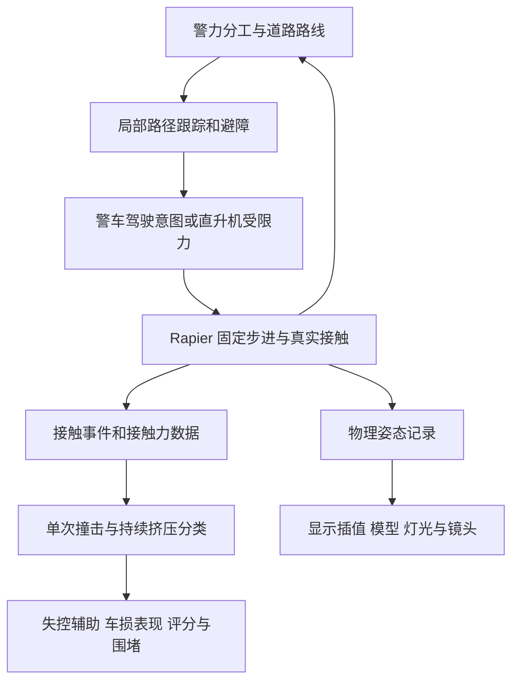

# 警车与直升机的追逐、碰撞技术设计

[返回文档地图](../MAP.md) · [车辆控制体系](车辆控制体系.md) · [车辆碰撞、翻滚与损伤](车辆碰撞翻滚与损伤.md)

调研日期：2026 年 10 月 31 日。依据为官方文档、原作者论文、本地 Rapier JS 0.21.0 声明及当前源码静态阅读。追捕现状以 `72ea785` 后的工作区快照为依据；调研期间其他任务仍在调整镜头、车控与交通，未提交内容不作为稳定交付承诺。初次交付为调研与设计；现已按用户要求接入当前工程，实现范围见下节，未接入其他候选库。原始问题表保留为调研基线，不表示这些缺口仍全部存在。已确认规则以[产品规格](../产品/产品规格.md)为准，实际验证以[执行计划](../计划/执行计划.md)为准。

## 当前落地与补充调研

- `police.ts` 与 `navigation.ts` 已接入方向道路、连续投影、道路内预测、槽位分工、ETA 截击与有限接触状态，使用玩家相同的动态街机底盘。警方通过底盘的 `yawLimit()` 接口将前视曲率映射为驾驶输入；共享街机车控接入时直接复用其实际横摆上限，AI 不重复维护一套转向常量。转向符号以底盘契约为准。
- 全图规划跨物理步共享 0.075 秒节流，单次只放行一次；同一真实道路 350 米内直接局部采样，已有远程路线等待更新时继续使用。截击先比较同路 ETA，跨道路只为最有希望的少量候选调用预算内寻路。实驾后将首警出生缩至后方约 80–160 米，初速接近玩家，创建即承担尾追，避免还没接近就失去观察。
- `collisions.ts` 共用步前质心、线速度和角速度，运动学交通用下一位置差求速度；接触流形提供世界点和方向，力事件与冲量形成分级信号。车辆按刚体归并，护栏按连续擦碰过程归并，离开约 0.25 秒后才允许新事故；普通接地不计。新事故沿用碰撞数、压力与连击规则，额外强峰只给反馈。
- `capture.ts` 要求至少两辆同层近车及前后真实阻塞，至少一向由警方形成；端部边界需面向行进方向，普通平行护栏不能单独完成夹堵。`engine.ts` 按所有动态警车与玩家所需空间块激活护栏。
- `airspace.ts` 和 `helicopter.ts` 已接入动态机身、受限 PD、65 m/s 演示速度上限、垂直速度限制、建筑和桥梁净空、遮挡记忆与地面通报。前向查询覆盖速度对应制动距离；受阻先查横绕和上方空间，无路时制动悬停。偏心受撞后先弱化控制，再以有限力矩恢复水平。
- 空中代理只提取标记的建筑、桥板下方厚度与桥墩；已建实体的护栏复用原有碰撞，不再把共享混凝土材质全部重复建体。空中代理、地面车体、轮胎查询、机身和碎片分组保持独立；机身不对玩家、警车和交通解算接触力。

补充核验明确了 `World.castShape()` 返回的 `normal1`、`witness1` 是命中碰撞体上的世界空间数据，而 `normal2`、`witness2` 属于被扫掠形状的本地空间；围堵端部方向据此判断，不能套用 pairwise shape cast 的坐标约定。射线查询结果在本地 JS 0.21 声明中直接提供 `collider` 对象。依据为项目本地依赖声明及[官方 World API](https://rapier.rs/javascript3d/classes/World.html#castShape)。

持续夹堵直接读取玩家少量接触图，不依赖力事件超过阈值；碰前速度快照和 `(线速度 + 角速度 × 接触点偏移)` 避免停车受撞漏记。`contactPair()` 的 `flipped` 先统一法线方向，再生成供车损使用的反向受力方向；临时事件仅在回调内读数。[官方接触图与事件语义](https://rapier.rs/docs/user_guides/javascript/advanced_collision_detection_js/)、[流形 API](https://rapier.rs/javascript3d/classes/TempContactManifold.html)。

当前代码已完成构建与独立只读审查；人工驾驶记录及尚未验收场景统一维护在执行计划。下文的调参值是设计起点，当前实际参数以源码与产品规格为准，不把预算或节流值当作稳定帧率证明。

## 推荐路线

继续使用 Three.js 与 Rapier。警车采用“真实道路路线 → 多车目标分配 → 前视路径跟踪 → 共享车辆控制 → 动态刚体碰撞”；直升机采用“短期预测目标 → 有限速度与加速度跟踪 → 空中避障与视线查询”。碰撞强度、持续接触和玩法反馈共用同一份物理事件，避免警车 AI、车损与围堵各自模拟一次撞击。

优先解决跨护栏直追、上下层误围堵、静止玩家被撞却不记碰撞、警车扎堆和高速追不上的问题。直升机首先承担侦察和调度，通过实体外壳与环境发生碰撞；不以搜索灯覆盖或与玩家平面距离近直接施加碰撞后果。

现有 1／2／4／7／10 辆警车、三级起 1／2／3 架直升机、警告不降低、累计 5000 米通关、翻倒与围堵失败、最高压力通关的 10 星条件继续作为边界。增加遮挡只影响警方获得的目标位置与追击效率，不改变警告或胜利规则。

## 当前实现与缺口

| 位置 | 静态阅读确认的现状 | 新设计需解决的问题 |
| --- | --- | --- |
| `src/game/engine.ts` 的 `updatePolice()` | 每车约 1–1.36 秒寻路；35 米内直追玩家速度外推 0.5 秒的位置，无路时也直追 | 隔栏、平行路和上下层道路不能仅按直线距离切换为冲撞 |
| `src/game/navigation.ts` 的 `RoadNavigation` | 共享三维坐标连接，所有边双向；端点吸附到最近节点 | 缺道路方向、车宽与转弯约束；端点吸附可能落到错误道路；返回路线尾端仍直接追加目标坐标 |
| `spawnPolice()` | 同一路段前后生成，前方车辆直接反向出生；`role` 只影响出生与重算间隔 | 缺出生占用和视野检查，也没有多车分工 |
| `updatePolice()` 的速度控制 | 目标速度封顶 53 m/s，约 190.8 km/h | 汽车配置为 210 km/h，摩托为 190 km/h；后方警车缺少持续高速追近余量。这是代码推导，非实测极速 |
| `src/game/physics.ts` | 玩家和警车已有动态车体、射线悬挂及 CCD，警方调用同一 `drive()` | 可直接复用底盘；AI 必须交付驾驶意图，不能改写位置来补寻路 |
| `processCollisions()` | 接触开始、求解后玩家速度至少 2 m/s、全局 0.8 秒冷却；统一禁用平衡 1.2 秒 | 漏掉停车被撞，无法区分轻擦、重撞和持续推挤；不同对象的撞击会互相吞掉 |
| 围堵与最高压力判断 | 分别主要依赖 5.5 米、180 米平面距离；围堵未检查实际接触或阻塞方向 | 桥上桥下、隔栏警车、同一侧聚集不能算真实夹堵或有效追击 |
| `updateRoadColliders()` | 只围绕玩家所在 500 米格激活 5×5 格护栏；无掉队警车回收 | 远处仍在模拟的警车可能失去边界碰撞 |
| 直升机更新及 `models.ts` | Three.js 模型直接跟随椭圆轨迹，绝对高度 32／44／56 米，灯光照向 y=0；没有刚体 | 无转弯惯性、爬升、避障、实体碰撞和实际视线；高架上灯光目标错误 |
| 场景生成与 `scenery-batch.ts` | 物理世界已有路面和附近护栏；建筑、桥板、桥墩主要是视觉实例 | 空中避障和遮挡必须补简化代理体，不能假定这些视觉模型已有物理几何 |

## 成熟方法及复用取舍

| 方法或资源 | 官方资料能确认的能力 | 本项目采用方式 |
| --- | --- | --- |
| Reynolds steering / OpenSteer 思路 | 区分行为选择、局部转向与运动执行；包括预测追逐、偏移追逐、到达、分离和避障 | 采用职责划分与行为组合，保留道路图及 Rapier 车控，不复制示例中的自由点质量移动 |
| Pure Pursuit | 从路径前视点计算目标曲率；前视距离影响响应与路径误差 | 作为警车路径跟踪器；选路与拦截仍由上层决定 |
| Yuka | 已有 Pursuit、OffsetPursuit、Separation、ObstacleAvoidance 等 JS 行为 | 可参考算法组织；现有工程只需要少量行为，不为本轮引入另一套车辆运动更新 |
| ORCA / RVO | 通过互惠速度约束让多个移动主体相互避撞 | 当前不接入；汽车不能瞬间切换任意横向速度，主动撞击也不符合互惠避撞目标。优先前向扫掠、减速与有限槽位分工 |
| Rapier | 动态刚体、射线车辆、形状扫掠、分组过滤、接触事件与接触力事件 | 直接复用现有依赖，所有实体碰撞保留在同一世界 |

依据：[Reynolds 原作者论文](https://www.red3d.com/cwr/steer/gdc99/)、[CMU Pure Pursuit 论文与原文](https://publications.ri.cmu.edu/implementation-of-the-pure-pursuit-path-tracking-algorithm)、[Yuka 官方文档](https://mugen87.github.io/yuka/docs/)、[ORCA 作者论文](https://gamma.cs.unc.edu/ORCA/publications/ORCA.pdf)、[Rapier 车辆 API](https://rapier.rs/javascript3d/classes/DynamicRayCastVehicleController.html)。表中采用顺序与成本是针对当前工程的判断，不是候选库的性能比较。本次不新增依赖或复制外部代码；后续若复制实现，按其实际版本保留许可证。

## 警车追逐

### 道路可达性始终有效

1. 导航边保留道路标识、行进方向、长度与高程，按数据中的 `oneWay` 建立正常通行方向。玩家预测按实际沿路速度的正负推进，不因单行标签自动纠正玩家方向。警方默认顺行；只有目标持续逆行约 0.5 秒、可在同一连续路面安全接近，且本车已顺着该方向或有足够掉头空间时，才启用逆行候选。路线成本按预计通行时间计算，反向边可先取双倍时间、方向切换另加约 3 秒，选定方向至少保持约 2 秒；空间变得不可通行时立即中止。具体数值待试玩，不把所有边无条件当双向，出生方向也必须符合本车当前行进状态。
2. 出发点、玩家位置和截击点先投影到连续道路段，再连接图。投影考虑上一段道路、相邻真实连接、高程和运动方向，不能只依赖最近节点或一项高程权重。
3. 对玩家做短期道路内预测：按当前沿路速度推进弧长，在真实分岔处分配少量候选路线。玩家选入另一匝道后重算，不把 `位置 + 速度 × 时间` 的任意空间点直接追加为可驾驶路线。
4. 近场追撞也保留道路走廊约束。只有目标与警车处于可直接接近的路面、车宽可通过且扫掠无护栏阻挡时，才从路径跟踪进入接触动作。距离小于 35 米本身不构成许可。
5. 找不到路线时，在现有道路内减速、沿当前有效路线重新取得目标；不退回跨隔离带直追。玩家掉头时重新选择行进方向，警车仍要完成有转弯半径的掉头或走真实连接。

前视控制器不能弥补图的断连，也不能证明道路没有障碍。路网保留实际连接，局部扫掠检查车宽与护栏；两者都满足才执行接近。

### 路径跟踪与速度控制

在本车当前路径弧长附近搜索投影，避免环路、回头路和立交交叉跳段。随后向前选取随速度增加的前视点；在局部道路平面中，用横向偏差和目标点弦长计算曲率：`κ = 2 × 横向偏差 / 弦长²`。若继续使用逐轮转向，可由 `转角 = atan(轴距 × κ)` 得到目标，再映射到现有 `steer` 范围；轴向和正负以本项目车控为准。[Pure Pursuit 原文](https://publications.ri.cmu.edu/storage/publications/pub_files/pub3/coulter_r_craig_1992_1/coulter_r_craig_1992_1.pdf)

前视距离可从 `clamp(8 + 0.45 × 车速, 8, 38)` 米起调，车速单位为 m/s。弯道前视点若造成车体扫掠越界，应缩短前视并降速，不能让轨迹切过匝道内侧护栏。Pure Pursuit 不保证自动满足车宽、转向半径与抓地限制。

目标速度取车型能力、追近需求、前方曲率、可用制动距离、交通避障与当前动作限制中的最小值。弯道可用 `v² × |κ| ≤ 允许横向加速度`，前方障碍可用 `v² ≤ v末² + 2 × 制动减速度 × 可用距离` 形成速度上限；这些是街机调校约束，不是完整轮胎仿真。

警车需要显式的演示极速配置，不能继续在 AI 中固定封顶 53 m/s。可先尝试约 230 km/h 的配置及相对玩家最多约 6 m/s 的追近余量，再按两车型试玩调整。直道有追近能力，入弯仍受同一制动和抓地限制；不因距离变大直接加速或传送到玩家身边。所有数值是未实测的初始建议，不修改产品现有车辆参数。

### 多车分工与撞击窗口

警车的目标是玩家沿道路移动形成的不同位置，而不是所有车辆共享玩家车体中心。

| 分工 | 目标与行为 | 进入接触的条件 |
| --- | --- | --- |
| 尾追 | 玩家后方沿路槽位，速度逐渐匹配 | 同层道路、前向空间可通行，允许有限追尾接触 |
| 侧夹 | 玩家左后或右后槽位，先并行再向内收 | 车道宽度允许、侧向轨迹无护栏，且已完成可见接近 |
| 前方截击 | 选择双方都能通过真实道路到达的前方路段，比较预计到达时间 | 先到达并形成拦截姿态；不能贴脸反向生成或瞬间横置车身 |
| 支援 | 保持更远纵向间隔，避让正在动作的警车 | 前车动作结束或失去位置后再补位 |

槽位先按警车到达成本和当前相对位置分配，再保留短暂占用时间，避免每帧左右换位。狭窄匝道退化为纵向追逐。初始最多允许两辆警车同时主动切入撞击，其余持续追赶与包抄；警力数量继续对应既定等级。

每辆车只需“追近 → 占位 → 接触动作 → 恢复”四个明确状态。接触动作前约 0.6–1 秒稳定并行或逼近，让玩家能从车辆与警灯识别方向；动作持续时间有限，失败后拉开并重新占位。道路边界、同伴避让与紧急制动优先于进攻，只有被指定撞击的玩家目标在动作窗口内允许主动接触。

碰撞来自动态车体的有限驱动力、转向与实际动量。不得在接触回调里再附加固定“撞飞冲量”，也不得突然改写速度、位置或朝向；否则 Rapier 已解算的撞击会被重复放大。受撞后短暂降低车控扶正与横向纠偏，保留被撞偏、挤压和翻覆的后果，强度规则复用[碰撞损伤调研](车辆碰撞翻滚与损伤.md)。

### 出生、掉队与围堵

新增警车从可达的道路入口或视野外路段驶入。候选点必须有足够直线路段、正确高程和车体空位；路线无法接近玩家则换候选，不以玩家前后固定世界距离生成。回收只作用于远离玩家、离开视野且没有参与接触的掉队车辆；HUD 数量、围堵和最高压力仍依据实际存在且有效参与的警力计算。

护栏激活范围改为玩家与所有仍在动态模拟的警车所需空间块的并集，并预留下一段制动距离。不能只保留玩家附近护栏，却让掉队警车继续在边界缺失区域运行；也不能在车体仍接触时卸载所在块。

围堵保留现有低速、约 5 秒累计和有效脱困后解除的节奏，但“两辆附近警车”改为“两辆确实参与阻塞的警车”：

- 警车与玩家高度和可驾驶层一致，有实际接触或车体尺度内的阻塞距离，隔栏不可达的车辆不计入。
- 至少有两个不同方向的限制，且玩家沿道路的前进、后退等可行脱困方向确实受到车体或道路边界约束；两辆都在同一侧而前方畅通不算夹堵。
- 瞬时低速、撞击抖动、轮胎空转不单独重置或触发；有效位移和持续恢复速度沿用现有解除规则。
- 最高压力的有效追击同样增加高程、可达性与追逐状态约束；不更改现有 20 秒、500 米及最终逃脱条件。

## 直升机追逐与碰撞

### 有惯性的跟踪和搜索

每架直升机分配不同的纵向、横向和高度偏移，跟随玩家短期预测位置。偏移以道路切向或稳定的玩家行进方向为参考；低速时保留上一有效方向，避免车辆原地旋转导致三架飞机同时绕圈。

机体保存位置、速度与朝向，采用有限 PD 跟踪：`期望加速度 = kp × 位置误差 + kd × 速度误差`，再限制水平加速度、爬升加速度、水平速度与爬升速度。目标跳变时平滑更新，不能立即将机体放到新的轨道点。旋翼旋转和视觉倾斜独立表现，不参与接触判断。这是本项目的简化控制建议，不声称模拟真实直升机空气动力学。

目标高度基于玩家实际道路高程和预定空中走廊内障碍顶部，再加净空余量。水平前向和向上形状扫掠确认可用空间，遇障碍优先减速、绕行或在确认上方畅通后爬升；没有局部通路则悬停或退出当前跟随槽位，不能直接穿过桥梁追到玩家头顶。首轮可用有限候选方向与高度解决，不先建立全城三维导航网格。

搜索灯指向玩家实际物理位置附近，正确跟随高架高度。识别依据为视线射线的首个命中，而不是 Three.js 光照是否看起来落在车上。桥面、桥板、建筑和隧道遮挡时，转为最近可见位置附近搜索；地面警车重新观察到玩家后可更新位置。短时遮挡可以有观察记忆，但不能继续将精确实时位置伪装为“已看见”。

### 实体外壳与场景代理

建议给直升机建立一个受控动态刚体及少量凸形机身碰撞体，正常飞行可设置 `gravityScale=0`，通过 `力 = 质量 × 受限期望加速度` 移动。航向以有限力矩跟随，碰后短暂降低跟踪控制，使其有可见让位和恢复；不强写下一位置消除接触。相比运动学机体，动态机体能在擦碰时响应外力，避免成为无法被推动的空中障碍。[Rapier 刚体类型](https://rapier.rs/docs/user_guides/javascript/rigid_bodies/)

机身与道路、空中环境代理和其他直升机保持真实实体接触；对玩家、警车和普通交通只探测近接并避让，不求解接触力。这样先完成空中擦碰与避障，不新增直升机撞翻玩家的失败路径。主旋翼只做动画，外缘可做避障探测，首轮不建立逐叶高速碰撞体。搜索范围若需要 sensor，独立于机身 collider；sensor 的交叠只表示探测范围，不产生接触力或伤害。[Rapier 碰撞体与传感器](https://rapier.rs/docs/user_guides/javascript/colliders/)

场景生成时补充建筑包围盒、桥板厚度和主要桥墩的简化代理，供附近物理碰撞与空中扫掠使用；静态代理按空间块维护，几何由生成场景的数据给出，不每帧遍历所有装饰网格。视线查询可共用这些几何，但要明确过滤探测器、自身和灯光辅助体。粗代理会产生少量保守避让，初期比旋翼、窗框等逐细节碰撞更适合当前范围。

首轮分组采用下表。表中“接触”表示实体求解，“查询”表示仅作为对应查询的目标；机身主动查询地面车辆仍可成立，不依赖双方开启实体碰撞。

| 被查询或接触的对象 | 地面车身 | 轮胎接地查询 | 直升机机身 | 视线查询 |
| --- | --- | --- | --- | --- |
| 真实可驾驶路面 | 接触 | 查询 | 接触与扫掠 | 查询 |
| 已有护栏 | 接触 | 忽略 | 接触与扫掠 | 查询 |
| 新增建筑、桥板底部与桥墩空中代理 | 忽略 | 忽略 | 接触与扫掠 | 查询 |
| 玩家、警车、交通车体 | 接触 | 首轮忽略 | 仅查询避让 | 目标车体参与识别 |
| 直升机机身 | 忽略 | 忽略 | 与其他机身接触 | 忽略自身 |
| 探测 sensor 与灯光辅助体 | 忽略 | 忽略 | 忽略 | 忽略 |

空中代理与真实道路分组分开，防止桥板底面或建筑粗盒变成车轮可驾驶表面，也不改变现有地面可驾驶边界。代理块激活范围覆盖各直升机当前位置、制动距离及前向扫掠走廊；仍有机身接触或下一次查询需要的块保留引用，离开后再卸载。几何激活先于本步查询和物理推进。

渲染阴影与玩法遮挡分开：即使只给一盏搜索灯开启阴影，所有直升机也必须执行自己的遮挡查询；若显示灯柱，灯柱长度在首个遮挡处截断。桥下玩家不能被灯柱穿桥照亮后仍称已处理遮挡。

首轮保留机身受撞、偏移和退出槽位的反馈，不新增坠机得分或坠落伤害规则。直升机不计入地面围堵数量；空中环境碰撞走统一接触记录，但不进入玩家事故计数。未来若增加直升机直接撞击玩家，应另行明确预警、接触速度上限及两车型失败公平性，再调整分组与产品规则。

## 统一碰撞管线

Rapier 的 `COLLISION_EVENTS` 只给接触开始和结束；`CONTACT_FORCE_EVENTS` 在求解后给接触力，须由相关 collider 开启并设置合理事件阈值。`world.contactPair()` 另提供接触流形；法线、位置与临时事件生命周期的处理统一按[碰撞损伤调研](车辆碰撞翻滚与损伤.md)实现。[官方事件语义](https://rapier.rs/docs/user_guides/javascript/advanced_collision_detection_js/)

建议游戏层保存“车辆对象对、接触时间、世界接触点、法线、碰前法向接近速度、撞击强度、是否持续挤压”。碰前速度包含接触点的转动速度；静止玩家被高速警车撞击也能识别。采用冲量或 `力 × 物理步长` 作为强度输入时，以车辆质量归一化后调校两车型；这不是材料破坏能量，不能直接拿总接触力当伤害。

每次固定步在车辆控制完成、物理推进之前保存参与车辆的质心、线速度和角速度；步后取得接触点，依据这份快照计算碰前接触点速度。开始/结束事件维护对象对的接触过程，每步通过 `contactPairsWith()` / `contactPair()` 确认仍在持续的真实阻塞，接触力事件提供强度峰值。持续夹堵不依赖超过力事件阈值，否则低力贴靠会被误当作已脱离。[Rapier 接触图](https://rapier.rs/docs/user_guides/javascript/advanced_collision_detection_js/)

事件按车辆对和接触过程归并，不能继续使用所有碰撞共享的 0.8 秒冷却。连续擦靠只算一次事故，持续压力供围堵读取；真正分离后再撞可产生新事故。若贴靠中发生新的强冲击峰值，允许失控与声音反馈，不把每个物理帧都累加事故。车身多个 collider 先归属到同一车辆，避免多部件重复扣分。

碰撞体建立车辆、路面、护栏、建筑、桥梁、机身与传感器的语义映射，替换“静态体高度小于零便忽略”的判断。正常轮胎支撑、sensor 和搜索灯不计事故；路面上的异常硬着陆可以独立分级。轻擦只产生轻反馈，强撞才较长时间削弱扶正与抓地；汽车翻覆、摩托摔倒仍由真实姿态持续时间判定，不因一次事件直接判负。

分类层只输出一份新的有效事故记录，统一供 HUD、警告、操控分和近失过程消费：玩家车体与车辆或护栏形成的新撞击过程，包括可辨识轻擦，均使 `metrics.collisions` 加一、警告压力沿用当前增加 12 的处理、连击清零且该次近失失效。严重度只调整失控持续时间、声音和外观反馈，不改变每次事故的现有扣分权重。普通接地、数值抖动、同次持续挤压和同车多碰撞体重复不新增事故；异常硬着陆先只提供反馈，不额外创造评分项目。需要改变轻擦是否扣分时，再作为产品计分规则变更处理。

高速玩家与追击警车保留已有 CCD。Rapier JS 0.21 还提供 `setSoftCcdPrediction()`，但不在未观察到具体问题前同时叠加多项参数；优先检查动态车体相对高速、薄护栏与多次连续接触，必要时再评估 CCD 子步。官方说明两辆开启 CCD 的物体仍可能穿透，因此 CCD 不能替代路线、避障和人工体验。[CCD 边界](https://rapier.rs/docs/user_guides/javascript/rigid_body_ccd/)、[软 CCD API](https://rapier.rs/javascript3d/classes/RigidBodyDesc.html#setSoftCcdPrediction)

前向 `World.castShape()` 只提供指定形状沿速度的首次命中等预测信息，不能当作已经执行物理移动，也不能完整覆盖转向过程中旋转车体的扫掠。用车宽及适当余量的近似形状，结合前视路径分段探测，保留最终动态碰撞。轮胎接地、道路避障和空中视线分别配置查询过滤；同一 collider 不能简单因为是动态物体就被所有查询排除。[场景查询与过滤](https://rapier.rs/docs/user_guides/javascript/scene_queries/)、[形状扫掠 API](https://rapier.rs/javascript3d/classes/World.html#castShape)

普通交通当前采用位置型运动学刚体，不会像动态车体一样被撞开，调研期间另有交通任务在修改其驾驶行为。双方可先以交通占用信息和车体扫掠协调避让；若后续需要交通被推行，应由交通模块统一完成运动方式切换及速度交接。本方案不自行叠加第二套交通车控，也不把运动学交通描述成已具备真实受撞响应。

## 接入边界与实施顺序

保留 `engine.ts` 的比赛与固定步长调度、`PhysicsVehicle` 的共享底盘、`RoadNavigation` 的道路拓扑和 `models.ts` 的外观职责。实现时将追捕状态与多车分工移出引擎，将直升机飞行控制独立于模型工厂；只在对应步骤确有需要时提取模块，不预建通用 AI 框架或新物理引擎适配层。

AI、围堵、碰撞和有效里程只读真实刚体，显示插值只服务模型与镜头。物理步顺序保持“驾驶与 AI → 物理推进 → 接触处理与玩法 → 记录显示姿态”；具体姿态采集可紧跟步进，但不能用插值后的显示位置回写物理。暂停冻结全部模拟计时，重开清除路线、槽位、接触过程和观察记忆；失败优先于同一步达到目标里程的结算顺序继续保留。

| 顺序 | 可独立交付的改动 | 必要的人工观察 |
| --- | --- | --- |
| 1 | 接触语义、按对象归并、碰前速度与强度；围堵增加高程和真实阻塞条件 | 停车被警车撞、轻擦、重撞、持续夹堵、桥上桥下与隔栏不误抓；两车型辅助失效合理 |
| 2 | 可靠道路投影、持续走廊约束、前视跟踪、曲率制动与护栏激活范围 | 主辅路通过真实匝道接近、不同桥层不直追、急弯制动、掉头与无路时不穿隔离带 |
| 3 | 明确警车追近能力、槽位、有限撞击窗口与合理出生回收 | 两车型持续高速仍有追逐、10 辆不同时挤一点、接近方向可识别、玩家有脱困窗口 |
| 4 | 直升机受限跟踪、环境代理、机身实体碰撞和灯光遮挡 | 高架灯光目标正确、桥隧遮挡后搜索、建筑前减速爬升、机身擦碰后恢复、三机互不重叠 |
| 5 | 联合调校和最终交付体验 | 完整 5 公里、围堵失败、翻车失败与 10 星通关；同时观察 10 警车和 3 架直升机下的帧耗时与资源情况 |

寻路与角色分配可先每车错峰约 0.5–1 秒更新，局部危险感知约 10–20 Hz，驾驶和机体受力保持 60 Hz；遮挡查询可约 5–10 Hz 并对显示平滑。这些仅是减少重复工作的初始预算，不能据此保证帧率。先使用现有空间分块与查询能力，出现实际耗时瓶颈后再决定是否引入后台线程或更复杂的搜索结构。

本轮代码落地执行必要编译与核心流程手动体验，不运行测试工程或文档校验；实际完成范围见执行计划，表中未覆盖场景不表示已经验证通过。
