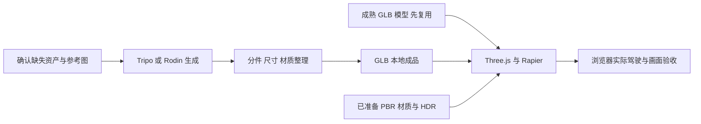

# 赞助资源与资产制作

[返回文档地图](../MAP.md) · [玩法与技术调研](玩法与技术调研.md)

调研日期：2026 年 10 月 31 日。本次已在 Chrome 重新查看比赛资源页，确认页面列示的 14 项资源；平台能力沿用此前对官方入口及文档的调研。下述分工、资产数量和试制顺序是建议，尚未生成或接入新资产。本次只查看和记录，没有领取、兑换或启动生成；不保存兑换码、账号、余额或密钥。

## 资源调用授权与用户接管

- 用户已确认这些资源由主办方提供，用于制作游戏相关资产。后续任务需要使用时，由代理自行选择合适资源并操作 Chrome，完成可用平台上的资产制作、下载与接入等步骤，无需就已授权的常规操作重复询问。
- 用户已授权安装和使用所需 CLI 或其他本地工具；按实际任务需要选择网页或本地工具，不提前安装整套平台工具。
- 遇到登录、注册、验证码或需要用户处理的操作问题时，请用户接管对应步骤，完成后由代理继续其余工作。
- 当前任务范围是记住资源和授权方式，暂不操作生成；后续资产制作在相应开发任务中按需开展。

## 项目缺口与资源使用原则

本项目全部采用 Three.js 相关网页技术，优先复用许可清晰的成熟模型、材质与场景模块。本轮仅确定方向，资源接入作为后续任务。

当前网页已有 32 条真实道路路径、车辆、交通、警追、菜单与评分。Poly Haven 沥青、混凝土、HDR 和中文字体源文件已转存 `public/assets/art/`，尚未由游戏代码加载；未接入外部 GLB 模型与完整视觉车损。先建立道路材质、环境光与近景车辆的画面基准，再补北京路侧设施和特色建筑。

## 赞助平台的能力与分工

权益以下列[官方活动资源页](https://vibecafe.ai/hacks/6?tab=tokens)为来源，只代表页面列示；实际到账、可用模型和剩余额度以各自账户为准。平台有某项功能，不代表比赛赠送额度覆盖该功能。

| 平台与官方来源 | 官方能力 | 对本项目的建议用途 | 比赛权益与边界 |
| --- | --- | --- | --- |
| [Unity／团结 Codely](https://codely.tuanjie.cn/topup) | 活动页提供 Codely 积分兑换入口，未说明具体资产生成能力 | 保留资源入口，具体用途待核对；项目继续采用 Three.js | 兑换窗口为 2026 年 10 月 30 日 00:00 至 11 月 1 日 00:00，兑换后 3 天内有效；活动页未列积分数量 |
| [Tripo](https://www.tripo3d.ai/zh) | 文生、单图与多视图生 3D；纹理、分件、重拓扑、绑定；GLB/FBX 等输出 | 补充车辆外观、警车和缺失路侧物件 | 每人 Pro + 3000 积分；Studio、API 可分别申请，额度独立；赛事结束后未用积分失效 |
| [Hyper3D Rodin](https://docs.hyper3d.ai/en/get-started/quick-start) | 文/图生 3D、PBR、[BANG 分件](https://docs.hyper3d.ai/en/api-specification/bang)、API/MCP；另有 WorldGen 与 HDRI | 与 Tripo 比较重点车辆；试制建筑或小街景 | 兑换后 4 天 Business，共享 80 个兑换名额；不能由会员时长推定无限生成或全部功能免费 |
| [V2FUN](https://v2fun.art/developers/api) | 图像与多视图、文/图生 3D、纹理/PBR、重拓扑、格式转换、视频动捕和动画重定向；GLB/FBX/USDZ | 统一概念图、模型备选；有骑手动作需求时再用动捕 | 每人 1 个月 Pro，每队另申请 5000 API 积分；网页与 API 额度分开，实际任务价格看控制台 |
| [Three.js](https://threejs.org/examples/) | 开源 3D 渲染库与官方示例，模型加载、材质、动画、实例化 | 本次唯一渲染与场景开发主线，配合 Rapier 完成物理 | 无需领 token；本身不生成模型、道路语义或完整游戏 |
| [硅基流动](https://docs.siliconflow.cn/docs/userguide/introduction) | 语言、图像、视频、语音及向量等模型 API | 概念图、材质参考、警方广播语音与宣传素材备选 | 云产品赠金，活动页未列固定金额；兑换截止 12 月 31 日；具体模型与消费范围需核对 |
| [AI Ping](https://aiping.cn/docs/PlatformOverview/product) | 模型服务评测、统一 API 与智能路由 | 比较可用模型，选择图像、视频或开发辅助服务 | 新用户登记可申请 68 元；额外最高 600 元依赖邀请与认证，不算现成可用预算 |
| [VibeToken](https://docs.vibetoken.cn/zh) | 兼容 OpenAI 的对话、图像和视频等统一模型 API | 概念图、图像编辑、UI 图片、预告片备选 | 每份 30 元，本批 60 份，兑换码无截止日期；不直接产出可驾驶 3D 资产 |
| [FUMO](https://fumolab.ai/zh/docs/) | Fusion 推理与编码模型，文本/图片输入，文本/工具调用输出 | 写资产整理、模型接入和场景摆放代码，分析截图 | $50 礼品卡，活动期间有效；不直接输出 3D 模型、图片或音频 |
| [Paean](https://www.paean.ai/en/about) | Agent、浏览器应用/游戏创作、发布与 Remix 网络；兑换入口属于 Paean One | 原型、展示与创作辅助备选 | 80 份、每份 5000 credits；兑换页到登录界面，未核实该权益可用模型、API 或资产导出能力 |
| [MiniMax Code](https://code.minimax.io/about) | 连接本地文件、工具与浏览器的编码/工作 Agent | 开发、整理资产和接入脚本 | 1 万积分用于 M 系列，领取后 30 天；11 月 2 日领取截止；不能推定可调用语音、音乐或视频 API |
| [GLM Coding Plan](https://docs.bigmodel.cn/cn/coding-plan/quick-start) | 官方支持工具中的编程模型与辅助能力 | 开发与资产接入代码 | 7 天、2000 体验积分，限从未订阅用户；不能用于标准 API，专用 Key 不通用 |
| [七牛云](https://developer.qiniu.com/aitokenapi) | 大模型推理平台，也提供图像与视频接口文档 | 先用于套餐支持的开发辅助，其他模态另核对 | 每人 2500 万 token、1 个月；不能据此换算图像/视频次数或假定覆盖全部模型 |
| [商汤小浣熊](https://xiaohuanxiong.com/download) | 本地文件、常用软件、定时任务与编码助手 | 文件整理和开发辅助 | 桌面端 3500 积分，共享 80 次，11 月 8 日 00:00 前兑换；不视为 3D 生成额度 |

[Tripo 官方说明](https://www.tripo3d.ai/help/api-plugins/tripo-studiotripo-api)区分 Studio 与 API 计费。短期先在工作台导出少量样品，确认可用再做 API 批量调用。FUMO、GLM、MiniMax 等开发资源选择顺手的一套即可，不需要全部接入。

## 已确认的 Three.js 路线

[Tripo 导出说明](https://www.tripo3d.ai/product-doc/export-and-integration/export-dcc)支持面向 Three.js 的 GLB；[GLTFLoader](https://threejs.org/docs/pages/GLTFLoader.html)可加载模型、PBR 材质与动画。Tripo、Rodin、V2FUN 的模型仍需核对实际导出、轴向、尺寸与分件；生成资产整理为网页可用的本地文件。当前代码尚未加入这些加载器和资产映射，不能把平台能力写成接入已完成。

图像、语音、视频与编码平台可继续用于开发期制作。游戏运行时使用下载到本地的成品。

## 推荐组合

以现有 Three.js + Rapier 工程为基础，先接入已准备的 PBR 材质与 HDR。V2FUN 或一个图像平台统一缺失资产的参考图，Tripo 与 Rodin 比较重点模型，整理为 GLB 后放入网页本地资源。成熟成品可直接采用时优先复用；图像平台和编码工具分别择一，不必将所有服务串联。

### 场景生成的适用位置

[Hyper3D WorldGen](https://hyper3d.ai/features/worldgen)支持从图像生成场景及独立可编辑物体，官方还介绍了接触关系、碰撞、质量与摩擦估算。调研时官方动态显示独立前景网格与 3D 高斯背景的组合。可先试一处路侧街景或车库，核对背景、前景、导出格式、尺度、Three.js 兼容性与本机渲染负担，再决定是否采用。

对本项目的判断是：物理估算不能直接视为北四环车道拓扑、匝道连接、警方导航和里程规则已完成。适合提取合格楼体、设施或局部装饰，实际道路与隔离带碰撞继续由地图和游戏工程控制。不能笼统说 WorldGen 没有物理，也不能承诺生成后可直接替代驾驶地图。

[Hyper3D HDRI](https://hyper3d.ai/features/omnicraft/ai-hdri-generator)可制作天空与环境光备选，当前 `public/assets/art/` 已准备的 Poly Haven HDR 应先整合。普通图像/视频生成适合参考、UI、贴图和宣传素材；路牌中文、车牌与仪表字样用正确文字单独绘制。

## 首批资产与试制顺序

风格遵循已确认的真实、统一方向。先固定日照、曝光、材质粗糙度与色调，再决定模型是否需要重做；不要混用风格化车、写实建筑和不协调光照。

| 顺序 | 目标 | 优先来源与完成条件 |
| --- | --- | --- |
| 首个样段 | 一辆主角车、一辆警车、约 300 米道路与少量路侧设施 | 沿用现有驾驶与路网，先用已准备材质/HDR 建立画面基准，再替换合格 GLB；车损单独实现 |
| 近景主体 | 汽车 1、摩托与骑手 1 套 | 成熟分件模型优先；确实缺少合适外观时，用同一参考图分别试 Tripo 和 Rodin |
| 交通 | 普通轿车、厢式车、公交/货车共 3 个模板 | 先替换现有交通外观，再按需求扩充车型；用车色和材质形成变化 |
| 路侧 | 护栏、路灯、隔音屏、路缘、信号灯共 5 个模板 | 现成模块优先；缺失的北京特色模块再生成，尺寸明确、能够拼接 |
| 城市特征 | 住宅、办公、沿街商铺、路段相符的入口/建筑共 4 个模板 | 复用通用楼体，生成特色局部；重复摆放建立道路两侧的连续性 |
| 后续 | 直升机、广播与展示素材 | 旋翼独立；语音与视频在核心驾驶样段验收后补充 |

同一辆车的 Tripo/Rodin 试制重点比较轮廓、分件可修性、贴图、材质和实际总消耗，再决定平台分工。先用少量积分试制，合格后扩充，保留修正预算；各平台积分不等值，基础生成、贴图、分件、重拓扑和导出可能分别扣费，不估算未经核对的成品数量。

比赛结束前优先下载已合格成果，服务内预览不等于文件已交付。[既有具体模型候选](玩法与技术调研.md#已找到的具体模型候选)仍只是候选；低模候选是否达到当前真实美术目标需重新评估。

## 可复制的制作提示词

提示词描述目标，不能保证一次产出就满足分件、轮轴或精度要求。具体年款和可使用的参考图比单独车型名更可靠。

### 车辆参考图

> 为北京北四环驾驶游戏制作真实比例车辆参考。单辆五门城市 SUV，全车完整，纯浅灰背景，柔和中性光照，清楚展示车窗、车灯、轮拱与轮胎结构。没有文字、品牌标志、其他车辆、地面道具、运动模糊和强烈反射。先给前侧四分之三视图，确认设计后补正侧面、前面、后面，保持车窗、车灯、车轮位置与车身比例一致。

不同视图必须是同一设计；冲突时减少输入，不让多视图引入矛盾。精确车型优先采用成熟可用模型或固定年款的参考。

### 车辆转 3D 与分件目标

> 根据已确认参考制作真实比例实时游戏车辆。车身与四个车轮独立，轮胎完整，不与挡泥板连接，轮心在轮毂中心，保持参考轴距与轮距。车身底部封闭、轮拱清楚，车门、引擎盖、玻璃与保险杠按后续车损需求可分离。干净网格与统一 PBR 材质，底色不烘焙强阴影和高光，不带地面或其他物体。

平台提供分件指令时再明确拆出车身与四轮；不能把指令视为结构已经合格。人形自动绑定不能替代车辆轮轴，生成模型也不会自动获得变形、掉件和玻璃破裂能力。

### 可重复路侧模块

> 单个北京城市快速路镀锌金属护栏模块，长 4 米，高约 0.8 米，两立柱，左右端可重复拼接，真实比例，清晰金属结构、轻微使用痕迹、统一 PBR 材质，纯浅灰背景。只出现护栏，不要道路、汽车、植物、文字或底座场景。

### 小街景概念与 WorldGen 试制

> 北京北四环路侧街景，真实比例，统一白天柔和光照，冷灰色现代住宅与办公楼、少量秋季树木、金属护栏和路灯。道路区域留空，建筑不侵入车道，无行人、无车辆、无悬浮物，招牌区域留白。用于拆分提取路侧楼体和设施，不要求精确复刻现实地理。

场景图用于确认色彩、密度与组合；WorldGen 导出后另核对可用性，最终摆放依据道路数据。

## Three.js 接入与实际验收

- 当前 `createVehicleModel()` 同步返回 `group`、`wheels`、`brakeLights`、`policeLights` 和 `dispose`，物理构造随即读取车轮位置。GLB 应先加载并缓存，再创建车辆；不能在构造期间返回尚未完成的模型。
- 统一米制、Y 向上、Z 朝前，车轮以轮毂中心作轴心并绕本地 X 轴滚动。汽车前轮排在前两项，摩托前轮排第一项；按实际轮径、轴距和车高校准射线悬挂与简化车身碰撞。
- 玩家、车库、普通交通和警车都使用模型工厂，模型与灯光节点要分别映射。缓存 GLB 的几何、材质和贴图可共享，但单车销毁不能释放其他实例仍在使用的资源；车损修改的几何也应与其他车辆隔离。
- 现有道路网格尚无 UV，沥青与混凝土贴图接入需补充按实际道路长度的 UV；色彩、法线、粗糙度与环境光要在跟车镜头共同验收。不能用文件已放入 `public/` 代替实际画面。
- 当前路外仍可行驶，隔离带碰撞未完整覆盖主辅路边界。应沿真实道路边缘补连续边界并保留连接口，避免用高面数外观直接充当所有动态碰撞。
- 车体变形、玻璃破裂与掉件仍需选择和接入网页方案；已有碰撞计数和刚体翻车不能视为视觉车损完成。
- 真实、统一的美术目标保留，按本机 Chrome 体验控制贴图尺寸、投影灯、可见物件与重复实例。优先复用少量高质量模块，资源分批接入后再决定是否需要进一步降低负担，不预设整张城市或所有模型一次加载。
- 资产在开发期生成并下载本地成品，游戏不依赖在线生成。每项记录平台、日期、原始来源、许可和修改说明；AI 生成不能保证品牌外观准确或任意再分发。
- 首段先人工确认驾驶、转向、接地、碰撞、灯光、重开和实际流畅度，车损实现后再确认其变形与掉件。未运行或未实现的项目不写为通过。
