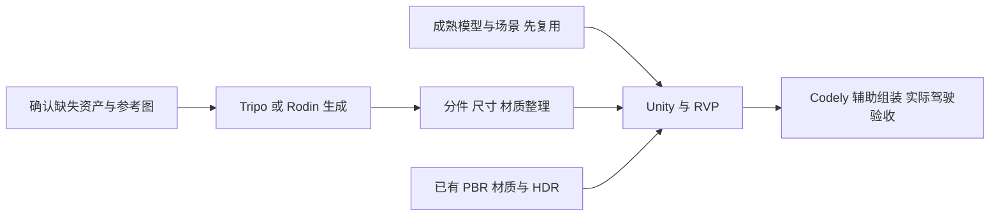

# 赞助资源与资产制作

[返回文档地图](../MAP.md) · [玩法与技术调研](玩法与技术调研.md)

调研日期：2026 年 10 月 31 日。已用 Chrome 查看比赛资源页及 14 个平台的官方入口，并补充官方文档。平台能力来自官方页面；下述分工、资产数量和试制顺序是建议，尚未生成或接入新资产。本轮未兑换权益，不保存兑换码、账号、余额或密钥。

## 项目缺口与资源使用原则

当前主线为 Unity + Randomation Vehicle Physics，优先复用成熟社区框架与美术资源，追求真实、统一的画面。车辆、城市模型与示例场景已导入，Poly Haven 沥青、混凝土与 HDR 源文件已取得，但 Unity 6 编译、运行与美术整合尚未完成。真实状态见[架构地图](../架构/架构地图.md)和[执行计划](../计划/执行计划.md)。

因此先整理已有车辆、场景、材质与光照，再用赞助平台补缺失的北京路侧设施、特色建筑和重点车辆外观。AI 不需要重新生成已有成熟资源。旧网页中的 32 条真实道路路径可供迁移，但尚不能称为 Unity 中已有可驾驶北四环场景。

建议保留 GIS 道路关系，复用 RVP 的车控、摩托、碰撞和损坏结构，生成或下载视觉模块后在 Unity 组装。图片中的城市、生成模型的网格细节和真实道路导航是不同层面的成果。

## 14 个平台的能力与分工

权益以下列[官方活动资源页](https://vibecafe.ai/hacks/6?tab=tokens)为来源，只代表页面列示；实际到账、可用模型和剩余额度以各自账户为准。平台有某项功能，不代表比赛赠送额度覆盖该功能。

| 平台与官方来源 | 官方能力 | 对本项目的建议用途 | 比赛权益与边界 |
| --- | --- | --- | --- |
| [Tripo](https://www.tripo3d.ai/zh) | 文生、单图与多视图生 3D；纹理、分件、重拓扑、绑定；GLB/FBX 等输出 | 补充车辆外观、警车和缺失路侧物件 | 每人 Pro + 3000 积分；Studio、API 可分别申请，额度独立；赛事结束后未用积分失效 |
| [Hyper3D Rodin](https://docs.hyper3d.ai/en/get-started/quick-start) | 文/图生 3D、PBR、[BANG 分件](https://docs.hyper3d.ai/en/api-specification/bang)、API/MCP；另有 WorldGen 与 HDRI | 与 Tripo 比较重点车辆；试制建筑或小街景 | 兑换后 4 天 Business，共享 80 个兑换名额；不能由会员时长推定无限生成或全部功能免费 |
| [V2FUN](https://v2fun.art/developers/api) | 图像与多视图、文/图生 3D、纹理/PBR、重拓扑、格式转换、视频动捕和动画重定向；GLB/FBX/USDZ | 统一概念图、模型备选；有骑手动作需求时再用动捕 | 每人 1 个月 Pro，每队另申请 5000 API 积分；网页与 API 额度分开，实际任务价格看控制台 |
| [Unity／Codely Bridge](https://codely.tuanjie.cn/product/bridge) | 连接 Unity/团结 Editor，操作 GameObject、组件、脚本编译、导入与引用资源 | 辅助摆放场景、建预制体、配置材质和接入资产 | 活动提供 Codely 积分；兑换截止 11 月 1 日 00:00，兑换后 3 天有效；不是 Asset Store 采购额度 |
| [Three.js](https://threejs.org/examples/) | 开源 3D 渲染库与官方示例，模型加载、材质、动画、实例化 | 保留网页参考或制作资产预览，不作为当前新增开发主线 | 无需领 token；本身不生成模型、道路语义或完整游戏 |
| [硅基流动](https://docs.siliconflow.cn/docs/userguide/introduction) | 语言、图像、视频、语音及向量等模型 API | 概念图、材质参考、警方广播语音与宣传素材备选 | 云产品赠金，活动页未列固定金额；兑换截止 12 月 31 日；具体模型与消费范围需核对 |
| [AI Ping](https://aiping.cn/docs/PlatformOverview/product) | 模型服务评测、统一 API 与智能路由 | 比较可用模型，选择图像、视频或开发辅助服务 | 新用户登记可申请 68 元；额外最高 600 元依赖邀请与认证，不算现成可用预算 |
| [VibeToken](https://docs.vibetoken.cn/zh) | 兼容 OpenAI 的对话、图像和视频等统一模型 API | 概念图、图像编辑、UI 图片、预告片备选 | 每份 30 元，本批 60 份，兑换码无截止日期；不直接产出可驾驶 3D 资产 |
| [FUMO](https://fumolab.ai/zh/docs/) | Fusion 推理与编码模型，文本/图片输入，文本/工具调用输出 | 写资产整理、模型接入和场景摆放代码，分析截图 | $50 礼品卡，活动期间有效；不直接输出 3D 模型、图片或音频 |
| [Paean](https://www.paean.ai/en/about) | Agent、浏览器应用/游戏创作、发布与 Remix 网络；兑换入口属于 Paean One | 原型、展示与创作辅助备选 | 80 份、每份 5000 credits；兑换页到登录界面，未核实该权益可用模型、API 或资产导出能力 |
| [MiniMax Code](https://code.minimax.io/about) | 连接本地文件、工具与浏览器的编码/工作 Agent | 开发、整理资产和接入脚本 | 1 万积分用于 M 系列，领取后 30 天；11 月 2 日领取截止；不能推定可调用语音、音乐或视频 API |
| [GLM Coding Plan](https://docs.bigmodel.cn/cn/coding-plan/quick-start) | 官方支持工具中的编程模型与辅助能力 | 开发与资产接入代码 | 7 天、2000 体验积分，限从未订阅用户；不能用于标准 API，专用 Key 不通用 |
| [七牛云](https://developer.qiniu.com/aitokenapi) | 大模型推理平台，也提供图像与视频接口文档 | 先用于套餐支持的开发辅助，其他模态另核对 | 每人 2500 万 token、1 个月；不能据此换算图像/视频次数或假定覆盖全部模型 |
| [商汤小浣熊](https://xiaohuanxiong.com/download) | 本地文件、常用软件、定时任务与编码助手 | 文件整理和开发辅助 | 桌面端 3500 积分，共享 80 次，11 月 8 日 00:00 前兑换；不视为 3D 生成额度 |

[Tripo 官方说明](https://www.tripo3d.ai/help/api-plugins/tripo-studiotripo-api)区分 Studio 与 API 计费。短期先在工作台导出少量样品，确认可用再做 API 批量调用。FUMO、GLM、MiniMax 等开发资源选择顺手的一套即可，不需要全部接入。

## 结合赞助平台的引擎选择

以下是针对当前游戏需求和工程状态的选型建议，不是一次新的引擎切换决定。结论为：完整游戏主线推荐 Unity；临近截止、优先保住已有可玩交付时使用现有 Three.js 版本；当前不建议增加 Godot 迁移。

### 平台资源并不绑定某个引擎

[Tripo 官方插件文档](https://developers.tripo3d.ai/en/docs/plugins)同时提供 Unity 与 Godot 插件；[导出说明](https://www.tripo3d.ai/product-doc/export-and-integration/export-dcc)也明确支持面向 Three.js 的 GLB。Godot 官方推荐 [glTF/GLB 导入](https://docs.godotengine.org/en/stable/tutorials/assets_pipeline/importing_3d_scenes/available_formats.html)，Three.js 有 [GLTFLoader](https://threejs.org/docs/pages/GLTFLoader.html)，Unity 可用 FBX 或官方 [glTFast 包](https://docs.unity3d.com/Packages/com.unity.cloud.gltfast@6.19/manual/index.html)。三种路线都能使用生成模型、PBR 贴图和动画，仍需适配各自材质、轴向、分件和物理。

通用编码、图像、语音与视频 API 也不决定引擎。赞助资源中更直接偏向 Unity 的是 Codely Bridge：它连接 Unity/团结 Editor，操作场景对象与组件、脚本编译、资源导入和引用。该功能为官方宣称，本项目尚未完成 Bridge 实际接入，不能把它算作已经可用的自动化能力。

### 按本项目的完成成本比较

下表是基于已核实资源与现有工程的判断，不是三种引擎的通用能力排名。

| 比较项 | Unity | Godot | Three.js |
| --- | --- | --- | --- |
| 生成模型与贴图接入 | FBX，或安装 glTFast 使用 GLB | 推荐 GLB，也支持 FBX | GLTFLoader 加载 GLB |
| 场景、材质和灯光制作 | 完整编辑器与预制体，适合整合已有车辆、楼体与 HDR | 完整场景编辑器，可使用相同资产 | 可做高质量画面，但场景组织、编辑与运行逻辑需要项目自行组合 |
| 汽车、摩托与视觉车损 | 已导入的 RVP 覆盖这些模块，版本兼容仍待确认 | 官方 Truck Town 可作四轮车起点，本轮未核实到同时覆盖摩托与车损的等价现成方案 | 已有汽车与摩托原型，视觉车损仍需补实现或接入其他库 |
| AI 协作 | 编码助手，加 Codely Editor Bridge 候选 | 编码助手、文本场景与插件；Tripo 已有官方 Godot 插件 | TypeScript 代码迭代和浏览器观察直接，已有工程可继续使用 |
| 当前能交付的基础 | 资源已导入，编辑器已安装，许可与首次运行待完成 | 尚无本项目 Godot 工程，需要迁移 | 已有构建和部分核心流程手动验证，最接近立即演示 |
| 本轮主要风险 | 账号许可、RVP 旧版本升级、规则与界面迁移 | 再换技术栈，并重新选择车辆、摩托、车损方案 | 将真实画面和视觉车损补齐时，自行组装的工作继续增加 |

### 推荐 Unity 的依据与限制

1. 项目同时要求汽车、摩托、多车种、翻车、变形、掉件、玻璃破裂及警追。现有 [RVP 原作者项目](https://github.com/JustInvoke/Randomation-Vehicle-Physics)更贴近这组组合需求；生成平台负责外观，现成车辆框架负责行为，减少重复开发基础能力。北京道路、警告、里程和结算仍由本项目实现。
2. 项目追求真实、统一的场景，Unity 的预制体、材质和编辑器工作流适合把成熟资源与生成资产放到同一驾驶场景中。Codely 是可选的加速工具，不能代替质量检查或保证所有编辑器操作成功。
3. 当前已有 Unity 工程、RVP 车辆与场景、PBR 材质和 HDR，后续投入可集中在整合与独有规则。需要先跑通才能确认这部分复用收益，不能由文件存在推断已经省下全部开发工作。

Unity 当前仍有实质交付风险：许可尚未激活；RVP 项目源于 Unity 2019.4，尚未在目标 Unity 6000.3.12f1 编译或驾驶通过。[Unity 官方升级指南](https://docs.unity.com/en-us/engine/6000.3/manual/upgrade-guides/upgrade-project)提醒直接跨越很老版本可能增加问题，并需确认第三方资产兼容。Codely 不能解决许可，也不能保证旧框架兼容。因此建议先通过许可、首次导入编译、汽车与摩托驾驶、车损和目标平台导出的实际验证关口，再大规模迁移 GIS、菜单与评分。此处只给出验证建议，本轮没有启动或构建引擎。

Godot 的资产接入与场景制作能力足够使用这些平台。[VehicleBody3D 官方说明](https://docs.godotengine.org/en/stable/classes/class_vehiclebody3d.html)明确提示其有已知问题，不面向真实车辆物理；这不表示 Godot 做不了街机驾驶，但不能把内置车控当成摩托、车损与警追的完整成品。[官方 Truck Town](https://github.com/godotengine/godot-demo-projects/tree/master/3d/truck_town)主要提供车辆物理示例，本轮未核实其具备所需摩托与车损组合。社区可能有其他方案，当前新增选型和迁移的收益尚未得到证据支持。

Three.js 的现有成果应保留为交付保障。生成资产同样能改善其画面，不能把网页库等同于只能画占位方块。若当前首要目标变为立即提供浏览器链接、短时间内保证可玩，现有 Three.js 版本优先级会高于尚未跑通的 Unity 工程。Unity 和 Godot 也能导出网页，但构建、加载和平台限制需要各自验证；不能承诺桌面工程无成本变成浏览器交付。

[Unity Web 官方兼容表](https://docs.unity.com/en-us/engine/6000.3/manual/platform-specific/webgl/intro/browsercompatibility)支持 macOS Chrome，但[Web 技术限制](https://docs.unity.com/en-us/engine/6000.3/manual/platform-specific/webgl/intro/technical-overview)涉及物理、音频、线程与网络，因此最终网页入口仍需体验碰撞、翻覆和围堵，不能用 Editor 运行结果代替。

## 推荐组合

以 Unity + RVP + 已取得的成熟资产为基础，Codely Bridge 辅助编辑器组装；V2FUN 或一个图像平台统一缺失资产的参考图；Tripo 与 Rodin 比较重点模型，选合适者继续制作。图像聚合平台、编码平台分别择一使用，不必将所有服务串联。

### 场景生成的适用位置

[Hyper3D WorldGen](https://hyper3d.ai/features/worldgen)支持从图像生成场景及独立可编辑物体，官方还介绍了接触关系、碰撞、质量与摩擦估算。当前工作台官方动态显示独立前景网格与 3D 高斯背景的组合。可先试一处路侧街景或车库，核对背景、前景、导出格式、尺度与 Unity 兼容性，再决定是否采用。

对本项目的判断是：物理估算不能直接视为北四环车道拓扑、匝道连接、警方导航和里程规则已完成。适合提取合格楼体、设施或局部装饰，实际道路与隔离带碰撞继续由地图和游戏工程控制。不能笼统说 WorldGen 没有物理，也不能承诺生成后可直接替代驾驶地图。

[Hyper3D HDRI](https://hyper3d.ai/features/omnicraft/ai-hdri-generator)可制作天空与环境光备选，当前已有 Poly Haven HDR 应先整合。普通图像/视频生成适合参考、UI、贴图和宣传素材；路牌中文、车牌与仪表字样用正确文字单独绘制。

## 首批资产与试制顺序

风格遵循已确认的真实、统一方向。先固定日照、曝光、材质粗糙度与色调，再决定模型是否需要重做；不要混用风格化车、写实建筑和不协调光照。

| 顺序 | 目标 | 优先来源与完成条件 |
| --- | --- | --- |
| 首个样段 | 一辆主角车、一辆警车、约 300 米道路与少量路侧设施 | 先整理 RVP 与已有城市资源，用已取得材质/HDR 建立实际画面基准；确认车辆可驾驶与车损 |
| 近景主体 | 汽车 1、摩托与骑手 1 套 | 成熟分件模型优先；确实缺少合适外观时，用同一参考图分别试 Tripo 和 Rodin |
| 交通 | 普通轿车、厢式车、公交/货车共 3 个模板 | 优先复用已有多车型，用车色和材质形成变化 |
| 路侧 | 护栏、路灯、隔音屏、路缘、信号灯共 5 个模板 | 现成模块优先；缺失的北京特色模块再生成，尺寸明确、能够拼接 |
| 城市特征 | 住宅、办公、沿街商铺、路段相符的入口/建筑共 4 个模板 | 复用通用楼体，生成特色局部；重复摆放建立道路两侧的连续性 |
| 后续 | 直升机、广播与展示素材 | 旋翼独立；语音与视频在核心驾驶样段验收后补充 |

同一辆车的 Tripo/Rodin 试制重点比较轮廓、分件可修性、贴图、材质和实际总消耗，再决定平台分工。先用少量积分试制，合格后扩充，保留修正预算；各平台积分不等值，基础生成、贴图、分件、重拓扑和导出可能分别扣费，不估算未经核对的成品数量。

比赛结束前优先下载已合格成果，服务内预览不等于文件已交付。[既有具体模型候选](玩法与技术调研.md#已找到的具体模型候选)仍只是候选；低模候选是否达到当前真实美术目标需重新评估。

## 可复制的制作提示词

提示词描述目标，不能保证一次产出就满足分件、轮轴或精度要求。具体年款和可使用的参考图比单独车型名更可靠。

### 车辆参考图

> 为北京北四环驾驶游戏制作真实比例车辆参考。单辆五门城市 SUV，全车完整，纯浅灰背景，柔和中性光照，清楚展示车窗、车灯、轮拱与轮胎结构。没有文字、品牌标志、其他车辆、地面道具、运动模糊和强烈反射。先给前侧四分之三视图，确认设计后补正侧面、前面、后面，保持车窗、车灯、车轮位置与车身比例一致。

不同视图必须是同一设计；冲突时减少输入，不让多视图引入矛盾。精确车型优先采用成熟可用模型或固定年款的参考。

### 车辆转 3D 与分件目标

> 根据已确认参考制作真实比例实时游戏车辆。车身与四个车轮独立，轮胎完整，不与挡泥板连接，轮心在轮毂中心，保持参考轴距与轮距。车身底部封闭、轮拱清楚，车门、引擎盖、玻璃与保险杠按后续车损需求可分离。干净网格与统一 PBR 材质，底色不烘焙强阴影和高光，不带地面或其他物体。

平台提供分件指令时再明确拆出车身与四轮；不能把指令视为结构已经合格。人形自动绑定不能替代车辆轮轴。生成模型也不会自动获得 RVP 的变形、掉件和玻璃破裂能力。

### 可重复路侧模块

> 单个北京城市快速路镀锌金属护栏模块，长 4 米，高约 0.8 米，两立柱，左右端可重复拼接，真实比例，清晰金属结构、轻微使用痕迹、统一 PBR 材质，纯浅灰背景。只出现护栏，不要道路、汽车、植物、文字或底座场景。

### 小街景概念与 WorldGen 试制

> 北京北四环路侧街景，真实比例，统一白天柔和光照，冷灰色现代住宅与办公楼、少量秋季树木、金属护栏和路灯。道路区域留空，建筑不侵入车道，无行人、无车辆、无悬浮物，招牌区域留白。用于拆分提取路侧楼体和设施，不要求精确复刻现实地理。

场景图用于确认色彩、密度与组合；WorldGen 导出后另核对可用性，最终摆放依据道路数据。

## Unity 接入与实际验收

- 先在现成 RVP 车辆上替换视觉子对象，保留控制器、轮轴、悬挂、碰撞和重心。FBX 与 PBR 贴图进入当前 Built-in 工程后重新配置材质，不直接假定 URP 材质或平台预览效果可复现。
- 对需要车损的车辆，保持 RVP 的网格与损坏部件引用；新车门、玻璃、保险杠和轮胎需正确映射。优先使用已具备这些结构的成熟模型，避免只换一体网格后丢失车损。
- 统一米制尺寸、朝向、轮心与轴距；碰撞几何和轮胎位置按框架预制体确认。模型看上去正确不等于车辆接地、转向与碰撞正确。
- 灯光、曝光、材质与模型一起在真实游戏镜头验收。先保证质感统一，不把极低面数和低分辨率贴图作为当前美术目标；确有运行问题时再针对实际瓶颈调整。
- 资产在开发期生成并下载本地成品，游戏不依赖在线生成。每项记录平台、日期、原始来源、许可和修改说明；AI 生成不能保证品牌外观准确或任意再分发。
- 首段只需人工确认驾驶、转向、轮胎接地、碰撞、车体损坏、玻璃/掉件、灯光和重开，再扩展街景。未在 Unity 实际运行前，不写为通过。

若以后保留网页展示，另导出 GLB；旧网页同步车辆工厂、轮子位置、预加载与共享资源释放有自己的接入约束，不能直接复用 Unity 预制体和脚本。当前优先完成 Unity 主线。
