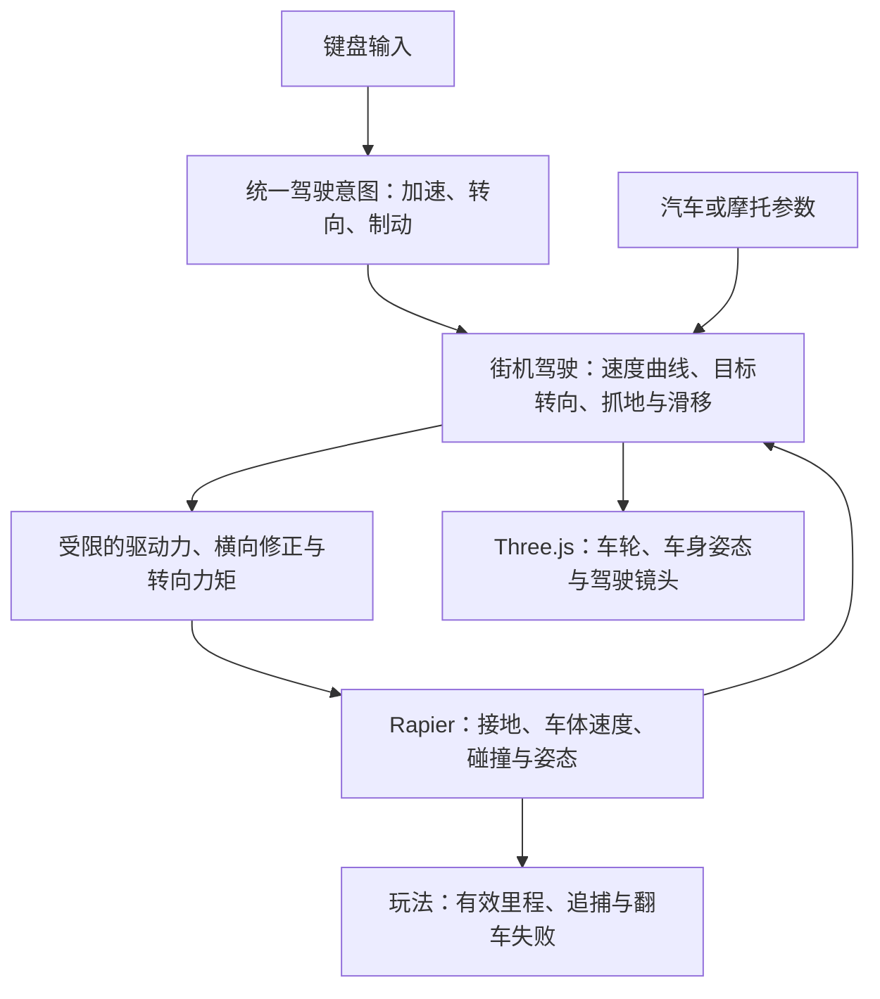

# 汽车与摩托车控制体系调研

[返回文档地图](../MAP.md)

调研日期：2026 年 10 月 31 日。范围是接入当前 Three.js + Rapier + TypeScript 工程的车辆控制、碰撞与驾驶镜头。结论来自官方文档、上游源码和本仓库静态阅读；没有安装、运行或比较候选引擎的性能。

车辆碰撞强度、翻滚辅助、外观车损和软体结构破坏的专项比较见[车辆碰撞、翻滚与损伤调研](车辆碰撞翻滚与损伤.md)。

## 已确认的体验方向

用户明确希望以《狂野飙车》《暴力摩托》式的抽象街机操控为方向，开动时具有更强的视角冲击。操控应直接、容易预测，高速可以大胆变线；汽车与摩托通过转向响应、车宽、滑移和姿态形成差异。实际范围以[产品规格](../产品/产品规格.md)为准。

对这些作品的引用用于表达体验目标，不代表已核实其内部物理算法，也不代表复刻其玩法。当前自由选择道路、护栏阻挡、警车撞击、翻车失败和有效里程规则继续构成控制系统的约束。

## 结论

建议沿用 Rapier，让它处理动态车体、路面接触、碰撞和翻覆，在上层建立轻量的街机驾驶规则。汽车与摩托共享输入、推进、转向、抓地和碰撞恢复流程，分别配置手感；摩托额外有压弯和有限平衡辅助。Three.js 负责把这些状态转化为车身、车轮和镜头表现。

当前已按这一方向接入共享街机驾驶核心和摩托视觉压弯，保留射线悬挂与 Rapier 碰撞，不引入多引擎适配层。实际实现与验证口径见[架构地图](../架构/架构地图.md)和[执行计划](../计划/执行计划.md)；下文的候选比较与物理边界仍用于解释取舍。

JoltPhysics.js 同时有可复用的汽车和摩托官方示例，是完整车辆物理的备选；它的两轮物理能力超过当前街机目标所需，迁移现有世界的成本也更高。cannon-es、Ammo.js 没有带来足以抵消迁移成本的本项目优势。

## 候选方案比较

| 方案 | 汽车 | 摩托车 | 与本项目的关系 |
| --- | --- | --- | --- |
| Rapier 动态车体 + 街机控制规则 | 自定义推进、转向与侧滑，保留碰撞和翻车 | 共享驾驶核心，增加压弯与可失效的平衡辅助 | 首选建议；沿用已经接入的物理世界，开发量集中在手感 |
| Rapier `DynamicRayCastVehicleController` | 内置逐轮驱动、转向、制动、射线悬挂和抓地 | 可以配置两轮，但没有专用两轮平衡和压弯控制 | 当前已用；适合作为接地与悬挂基础，不能只删两轮便视为完成摩托 |
| JoltPhysics.js | `WheeledVehicleController` 与官方四轮示例 | 专用 `MotorcycleController` 与官方两轮示例 | 功能覆盖完整；若未来把物理车辆表现作为核心，再独立评估迁移 |
| cannon-es `RaycastVehicle` | 有逐轮控制、悬挂和轮姿态同步 | 仍需单独提供平衡与压弯 | 适合新的轻量 JS 工程；当前切换会重接已有道路与碰撞 |
| Ammo.js / Bullet | 有 `btRaycastVehicle` 路线 | 通用射线车不能自动补齐两轮控制 | 可借鉴既有算法；当前没有必要另接一套 WASM 世界 |
| PHY / Sketchbook | 有汽车示例和较多游戏封装 | 本轮未核实到满足本项目要求的即用摩托体系 | 适合参考局部代码，不作为整体替换方案 |

Rapier 的[官方控制器说明](https://rapier.rs/docs/user_guides/javascript/character_controller/#vehicle-controller)与 [JS API](https://rapier.rs/javascript3d/classes/DynamicRayCastVehicleController.html)确认其单动态车体、射线轮和逐轮参数的边界。Three.js 提供[可操作示例](https://threejs.org/examples/physics_rapier_vehicle_controller.html)及[源码](https://github.com/mrdoob/three.js/blob/dev/examples/physics_rapier_vehicle_controller.html)。cannon-es 的对应能力见[官方源码](https://github.com/pmndrs/cannon-es/blob/master/src/objects/RaycastVehicle.ts)，Ammo.js 的绑定和许可证说明见[官方仓库](https://github.com/kripken/ammo.js)。表中适配成本和选型排序是结合本仓库现状的工程判断，没有做性能排名。

## 推荐的街机控制体系

这是职责示意，不是预建模块目录。开始实现时只提取当前需要调校的职责，保持玩家与警车调用简单。

### 共享的驾驶核心

- 加速：油门控制可调的加速度曲线和演示极速；起步迅速、高速收敛，松油门有明确减速。无需先建立发动机、离合器、齿比和真实轮胎模型。
- 转向：方向输入转换成随速度变化的目标横摆速度或曲率，平滑跟随；低速易掉头，高速限制单次转向幅度，避免轻按方向就甩出道路。
- 抓地：默认快速收敛不需要的横向速度，使玩家容易沿意图行驶；仍让实际撞击和路面约束影响车体，不逐帧强制写回位置和朝向。
- 滑移：汽车在高速大转向时减弱横向修正，形成少量可恢复侧滑；同时刹车和转向时侧滑更明显，但空格继续承担正常制动。摩托保持更强抓地，未增加独立漂移操作。
- 碰撞：在碰撞后的一段时间削弱驾驶修正和平衡辅助，保留被警车挤压、撞偏和翻倒的后果；恢复应平滑，不能在下一步直接把速度和姿态拉回目标。
- 离地：停止地面抓地修正，保留刚体飞行与落地；接地状态继续参与里程判断。

当前由街机层统一计算推进、制动、横向抓地和偏航，射线车不再额外施加逐轮发动机、刹车及侧向摩擦。悬挂与地面查询继续复用 Rapier，里程保留轮胎接地条件；汽车至少两轮接地才获得驾驶修正。该分工避免两套控制力相互对抗，具体速度与响应仍需人工调校。

### 两种车辆的区别

| 调校维度 | 汽车 | 摩托车 |
| --- | --- | --- |
| 通过空间 | 更宽，需要提前选线 | 更窄，突出穿行机会 |
| 转向响应 | 快速响应与回正，以轻微侧滑体现车重 | 更迅速，高速仍有幅度限制 |
| 横向滑移 | 可用车尾外甩表现动态 | 以快速变线和压弯为主，避免套用同一车尾甩动动画 |
| 姿态 | 少量车身侧倾、加速抬头与制动点头 | 明显视觉压弯，低速回正；不要求玩家自行维持两轮平衡 |
| 受撞后果 | 偏航、减速、可能翻覆 | 平衡辅助暂时失效，可能摔倒 |
| 镜头 | 低机位、平滑后拉 | 可以稍低、更快响应转向，并适度侧倾 |

视觉压弯与物理辅助可以分别调校：视觉层放大驾驶姿态，动态车体维持可玩性并承担真实碰撞。失败和里程继续依据物理车体，不能因为画面上的压弯角大而误判摔车，也不能把视觉压弯当作已经实现的两轮动力学。

如果未来需要物理车体也随弯道倾斜，可增加有限的目标倾角和姿态力矩；平路稳定转弯的 `倾角 ≈ atan(横向加速度 / 重力加速度)` 只能作为参考。当前目标可直接用车速、输入和横摆速度驱动视觉压弯，不必先实现反打、陀螺效应或骑手重心模拟。

### 镜头与速度冲击

用户已经确认需要强化开动时的视角冲击，镜头是驾驶反馈的一部分。优先使用成本低、道路仍清楚的方式：

1. 起步和持续加速时短暂后拉，并扩大视野，让加速立即可感。
2. 随车速逐渐提高视野、降低机位，放大道路标线与路侧设施的掠过感。
3. 转向加入小幅侧倾，摩托比汽车更明显，但不让镜头完全跟着车体翻滚。
4. 对加速度信号限幅和平滑，暂停、重开和后视切换保持可控，避免把一次速度突变放大为持续冲击。

镜头读取车辆状态，不反向参与车体或里程计算。当前不需要为速度感先引入全屏运动模糊、逐帧随机抖动或复杂后期管线。实际已落地的效果与验证范围见[架构地图](../架构/架构地图.md)和[执行计划](../计划/执行计划.md)。

## 现有工程可以复用什么

以下源码观察以调研开始时的 `ce81f13` 为基线，不代替后续提交中的实现状态。

- `src/game/physics.ts` 已用 Rapier 射线车，汽车四轮、摩托前后两轮，具备速度相关转角、输入平滑、逐轮推进/刹车、低重心和 CCD；不需要从空白搭建车辆物理。
- 当前摩托使用扶正力矩，尚无明确的目标压弯控制或独立的视觉压弯动画。碰撞后禁用平衡辅助 1.2 秒；触发来自带速度门槛和冷却的接触事件，尚未依据碰撞冲量区分轻擦与强撞。
- `src/game/engine.ts` 使用固定 60 Hz，玩家与警车共用 `PhysicsVehicle`；普通交通单独按道路作运动学移动。不能把所有道路车辆都按同一动态车控升级。
- 里程直接读取轮胎接地，并结合道路位置、姿态和实际位移判断；翻倒失败依据物理车体向上方向及持续时间。替换控制实现时必须保留可靠接地和姿态数据。
- `src/types.ts` / `src/config.ts` 的 `handling` 目前只用于界面展示，未参与实际转向。落地时应让可调参数对应具体行为，不能把展示数值当成已生效的操控能力。

现有车控和引擎直接使用 Rapier 世界、车体、碰撞体句柄与接地查询。保持 Rapier 的成本较低；若换 Jolt，还需重接道路碰撞、护栏、交通、警车、事件和资源释放，无法仅替换玩家的一辆车。

## 使用射线车时的具体边界

Rapier 的[车辆源码](https://github.com/dimforge/rapier/blob/master/src/control/ray_cast_vehicle_controller.rs)可解释以下机制；实际 JS 调用以项目锁定依赖和[公开 API](https://rapier.rs/javascript3d/classes/DynamicRayCastVehicleController.html)为准，不能将 Rust 与 JavaScript 的同号版本直接等同。

- 每个轮胎是沿悬挂方向的单条射线，没有完整轮胎碰撞体；车体的 CCD 不会把轮射线变成有体积的轮胎。路缘、护栏顶面和匝道坡脚可能造成突变，优先把可驾驶面与护栏分组查询。
- `updateVehicle(dt, filterFlags, filterGroups, filterPredicate)` 可以筛选接地查询；当前已经用 predicate 排除本车。查询过滤必须继续允许真实可行驶坡面和需要承托车辆的动态物体，不能简单把所有动态物体排除。
- `setWheelEngineForce` 输入为力；`setWheelBrake` 输入为最大制动冲量。按米、千克、秒配置时，两者不能当作相同单位随意混调；改变物理步长时应重新核对制动。
- `frictionSlip` 与 `sideFrictionStiffness` 控制轮胎冲量能力，不能分别当作真实滑移率和完整轮胎模型。拉大抓地值也可能让车体更易被转向力掀翻，不等于街机稳定辅助。
- 车轮视觉需要同步悬挂长度、转向和滚动角；外部模型的车轮分件、轴向与旋转中心仍需适配。模型本身不携带驾驶手感。

## Jolt 的真实两轮能力与采用条件

官方 [JoltPhysics.js 示例目录](https://jrouwe.github.io/JoltPhysics.js/)同时提供[汽车](https://jrouwe.github.io/JoltPhysics.js/vehicle_wheeled.html)和[摩托](https://jrouwe.github.io/JoltPhysics.js/vehicle_motorcycle.html)。核对到的 JS 仓库快照为 `784c98c0c09e51c6d47700bc16fbbe8c211eb434`。

[该快照的摩托源码](https://github.com/jrouwe/JoltPhysics.js/blob/784c98c0c09e51c6d47700bc16fbbe8c211eb434/Examples/vehicle_motorcycle.html)直接创建 `MotorcycleControllerSettings`、前后两个 `WheelSettingsWV`、圆柱体扫掠接地测试器和车辆步进监听器，并读取车轮变换给 Three.js。这证明相关能力已进入 JS/WASM 示例，而非仅存在于原生 C++。

[Jolt 原生摩托控制器](https://github.com/jrouwe/JoltPhysics/blob/master/Jolt/Physics/Vehicle/MotorcycleController.h)提供最大倾角、倾斜弹簧、阻尼和积分等控制；头文件仍提示该控制器处于开发中，需要具体调校。后续专项调研确认，该快照的 [JS 绑定](https://github.com/jrouwe/JoltPhysics.js/blob/784c98c0c09e51c6d47700bc16fbbe8c211eb434/JoltJS.idl)已暴露 `EnableLeanController(boolean)`，可关闭摩托平衡辅助。其他原生方法仍须逐项核对选定 npm 版本，不能一概视为 JS 可用。

采用 Jolt 需要明确收益：例如希望实际车轮与路缘的接触、物理压弯和悬挂表现成为核心玩法。当前街机目标没有这一必要性。官方 [JS 接入与内存说明](https://github.com/jrouwe/JoltPhysics.js)还要求处理 WASM 载入和原生对象生命周期；可参考其释放示例，不直接照搬演示页的长期资源管理。

## 复用与许可

- Three.js 为 MIT，Rapier 为 Apache-2.0，继续使用当前依赖的许可声明与随包分发方式；外部示例或资源接入时保留对应来源。
- [JoltPhysics.js](https://github.com/jrouwe/JoltPhysics.js)采用 MIT；[cannon-es](https://github.com/pmndrs/cannon-es)采用 MIT；[Ammo.js](https://github.com/kripken/ammo.js)说明采用与 Bullet 相同的 zlib 许可。许可证不覆盖从其他地方取得的车型模型、品牌图案和音效。
- [PHY](https://github.com/lo-th/phy)采用 MIT，提供 Three.js 的多物理引擎封装；核对快照 `7fe6ca802f581bfdeb3835147bb1923f372cc622` 的[射线车示例](https://github.com/lo-th/phy/blob/7fe6ca802f581bfdeb3835147bb1923f372cc622/demos/ray_car.js)仍标记为建设中。多后端列表不等于各后端车辆功能已经一致，不建议为它再包一层现有 Rapier。
- [Sketchbook](https://github.com/swift502/Sketchbook)原作者已停止开发并归档，README 的车辆类型为汽车、飞机和直升机；可参考第三人称驾驶与模型接入，不能据此承诺现成摩托控制。

本次没有引入这些候选依赖或复制上游实现。

## 建议的落地顺序

1. 先强化起步、加速和高速镜头，保持当前物理与玩法能正常运行。
2. 再用同一路段调校汽车与摩托的加速、方向响应和默认抓地，使按键意图稳定可预测；每次只调整能直接感知的一组参数。
3. 增加摩托视觉压弯与汽车姿态，保持视觉表现、物理车体和失败判定分工明确。
4. 只有确实需要甩尾或不同接地方案时，才补对应控制规则；不要同时重写地图、AI 和整个物理系统。

后续车控实现只做必要的编译与人工核心流程：两车型起步和刹停、高速变线、主辅路坡道、护栏阻挡、警车撞击、摩托压弯与摔倒、暂停/重开/后视，以及里程和失败判断。没有执行这些流程时，不宣称驾驶手感或稳定性已经验证。
